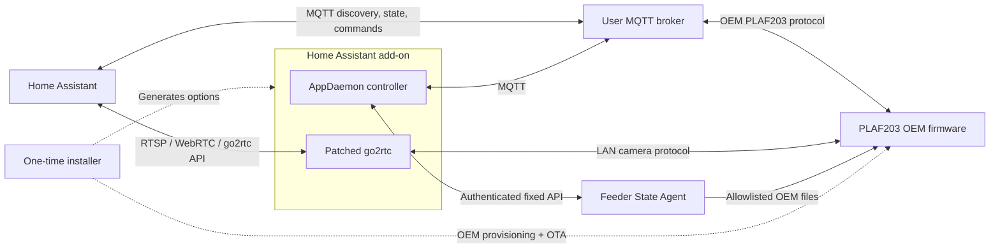

# Architecture

Petlibro Local keeps device bootstrap, feeder-resident state access, Home
Assistant control, and camera transport in separate trust and runtime domains.



## Component boundaries

### Unified installer

[`installer/`](../installer/README.md) is a setup-machine tool used once on a
stock, already claimed feeder. It captures the feeder's OEM broker identity,
checks the final broker, sends the one-time OEM OTA bootstrap, restores the OEM
firmware slots, redirects the feeder to the user's broker, observes a fresh OEM
heartbeat when possible, and generates the matching add-on options.

The installer also builds a pinned Dropbear release from official source using
a checksum-verified Zig musl toolchain. The production payload always installs
public-key-only SSH recovery access; password authentication is compiled out.
All acquisition and build state remains in the ignored repository-local
`build/bootstrap/` workspace.

This is the only production component allowed to use the unauthenticated OEM
provisioning and OTA surfaces. Those capabilities do not exist in the installed
State Agent API.

### Feeder State Agent

[`state-agent/`](../state-agent/README.md) is a small C service running beside
the unchanged OEM firmware. It reads only fixed OEM state files, validates
their shape, and returns decoded state and revisions derived from the same
per-request buffers over an authenticated source-IP-restricted HTTP API. The
read-only boundary cannot promise one atomic generation across files that the
OEM firmware may update independently.

It also accepts one signed, fixed-format agent update upload. A runit supervisor
performs durable candidate activation, probation, and single-backup rollback.
There is no arbitrary file, path, command, shell, or package-management API.

### Home Assistant add-on

[`addon/`](../addon/README.md) packages two independent s6 services:

- the AppDaemon controller, which handles feeder MQTT, Home Assistant entity
  projection, State Agent reconciliation, and signed update orchestration;
- the go2rtc fork, which handles LAN camera discovery, Petlibro media transport,
  and standard streaming outputs.

Home Assistant options are rendered atomically into service configuration under
`/data`. s6 owns restart and shutdown behavior; neither application supervises
the other.

## State ownership

The integration distinguishes state by authority and lifetime.

| State | Authoritative source | Home Assistant behavior |
| --- | --- | --- |
| Persistent feeder settings | State Agent `/v1/core` | Reconciled and retained for presentation; writes require fresh verification |
| Feeding plans | `plans.semantic_records` in State Agent `/v1/core` | Complete-collection reconciliation and verification |
| Current dispensing state | Solicited `ATTR_GET_SERVICE.motorState`, then grain events | Non-retained, dedicated availability |
| Runtime telemetry | OEM MQTT events/attributes | Projected as live observations |
| Last feed observations | Completed grain-event sequence | Retained historical facts |
| Camera runtime | go2rtc status file | Validated and projected to MQTT |

The State Agent labels decoded core fields as:

- `persistent`: file-backed configuration suitable for command verification;
- `effective_cached`: firmware-computed cached state, informational only;
- `runtime`: opportunistically persisted telemetry/machine state.

An MQTT acknowledgment proves only that firmware accepted a command. The state
coordinator reads a new State Agent revision and verifies the requested value
before changing its model. If reconciliation fails, persistent controls become
unavailable rather than using retained Home Assistant values as feeder truth.

Connection lifecycle work is distinct from coordinator readiness. State Agent
update checks and compatibility reconciliation run when combined MQTT/state-API
availability becomes usable, not on every `READY` transition after a settings
write or truth refresh. Home Assistant birth still republishes projections and
runs its dedicated update/compatibility hooks; confirmed State Agent updates
retain their separate compatibility reconciliation hook.

## Operational error lifecycle

The device error diagnostic is independent of availability. The controller
keeps one latest unresolved observation in each of seven fixed categories:
no-food, outlet, motor, scheduled execution, portion mismatch, unknown, and
other device errors. The existing Home Assistant entities show the latest
outstanding category. Resolving it reveals any remaining incident, including
an independent NTP failure. There is no persistent incident store or event
history; controller restart starts a new observation session, not a physical
recovery.

Known no-food, outlet/switch, motor, and portion-mismatch incidents may resolve
after a newer, coherent successful feed. Scheduled execution failure 2003
requires a successful scheduled feed. Unknown and unrelated device errors are
not resolved by feeding. Command rejections remain contextual warnings and
coordinator feedback, rather than persistent hardware faults.

Recovery requires an observed start/end pair with matching ID, trigger type,
plan ID and retry context, consistent positive expected counts, full actual
output, `finished=true` at the end, and no error observed for that operation.
Its start must follow the incident in both device execution time and local
observation order. The feeder must be online, and both phases and the failure
timestamp must be fresh at receipt under the existing 10-second clock-drift
tolerance. This is an evidence check, **not** a timeout that clears errors.
Only one candidate and the most recent terminal execution timestamp are kept;
the latter survives reconnects for this controller session so completed-feed
replays cannot masquerade as newly started operations. Only fresh terminal
timestamps update that bound.
Blocking, conflicting/reused identities, stale or
incomplete records, disconnect, device restart, and clock correction prevent
recovery inference. Uncertain cases remain unresolved until stronger evidence
is available or the diagnostic session ends.

The backend retains the code, category, event/receipt timestamps, and available
grain context rather than reducing failures to strings. Existing bounded
cross-event deduplication also covers uncoded portion mismatches. It is not a
permanent replay ledger: a sufficiently late old failure may be reported again
after deduplication expires, conservatively, rather than risking false clearing.
Observed recovery means dispensing capability was subsequently demonstrated;
it does not mean a missed meal was compensated, every bowl received food, or a
mechanical fault was permanently repaired.

NTP recovery remains separate: a calibration response being sent is not
successful synchronization. An in-tolerance device-time observation or a
matching successful `NTP_SYNC` acknowledgement with an in-tolerance timestamp
can clear an NTP failure, but never an operational incident. Settings writes,
reconnections, State Agent updates, and Home Assistant birth do not themselves
resolve incidents. Birth republishes the current diagnostic.

## Dispensing runtime ordering

At first heartbeat, feeder reconnect, and `homeassistant/status = online`, the
controller sends a correlated `ATTR_GET_SERVICE` request. Recognized live
`motorState` values map as follows:

- `1`: Dispensing;
- `2`: Idle;
- `3`: Recovering;
- `0`, malformed, unknown, or timeout: unavailable.

After bootstrap, `GRAIN_OUTPUT_EVENT` immediately drives Dispensing, Blocked,
and Idle transitions. Each runtime request records the feeder connection
generation, request `msgId`, and local grain-event generation. A response from
an old connection, for a different request, or overtaken by a newer grain event
cannot overwrite current state.

Raw motor GPIO is not used: the OEM state machine can intentionally stop the
motor during an active dual-bowl transition, so stopped pins do not prove Idle.
The file-backed `motor_state_raw` is also not current enough for this purpose.

`food_output/progress` and its availability topic are non-retained. The four
last-feed observations are retained because they describe completed history,
not current actuator state.

## Discovery and camera flow

The controller learns feeder serial/product identity from MQTT and camera UID
from `DEVICE_START_EVENT`. Device discovery resolves the current feeder address
using the UID-specific LAN_SEARCH3/KNOCK2 exchange and writes a private device
registry. AppDaemon is the registry's persistent owner; the go2rtc renderer
merges manual overrides only into its in-memory render view so concurrent
service startup cannot replace newer discovery state. Only resolved devices
receive go2rtc stream entries.

When registry changes alter `apps.yaml`, AppDaemon's normal one-second utility
loop observes the atomically replaced file through its app-directory symlink.
It initializes new device apps, reloads changed definitions, and terminates
definitions removed from that file; a service restart is not required.

The go2rtc `petlibro://` source opens on demand. Its camera path has three
responsibility layers:

```text
go2rtc Producer (codec declaration and RTP forwarding)
  -> PLAF203 Camera adapter (physical session, readiness, SPS observation, clocks)
    -> Petlibro Client transport (discovery, IOCtrl, ACK/reorder/reassembly)
```

The transport converts Petlibro/TUTK datagrams into complete H.264/AAC access
units while preserving raw camera clock observations. It has no RTSP, WebRTC,
or downstream-consumer policy. The adapter owns the physical viewing session:
startup retries, the observed low-to-HD SPS transition, an initial
SPS-bearing IDR with continuous live GOP handoff, timestamp normalization,
status, and a best-effort `IPCAM_STOP` before transport shutdown. If startup
stabilization has consumed video after its saved IDR, the adapter resynchronizes
at the next SPS-bearing IDR rather than exposing a reference-frame gap.
STOP transmission is not an
acknowledgement that the physical camera has deactivated. The adapter observes
later SPS epochs for media forwarding and status, but does not renegotiate the
producer's initial go2rtc codec/SDP description.
The go2rtc producer sees only normalized media units and standard codec
descriptions. Multiple downstream consumers continue to share go2rtc's normal
single source instance.

The adapter writes one private atomic status JSON file per stream. AppDaemon
validates that internal file and publishes the stable
[camera MQTT contract](mqtt-camera-contract.md); frontend consumers do not
depend on go2rtc internals.

## Network and security boundaries

- Host networking is required for LAN UDP discovery and practical WebRTC.
- Feeder MQTT uses a separate least-privilege broker identity from the add-on.
- The State Agent requires bearer authentication and a fixed source-IP ACL.
- State Agent updates require a pinned Ed25519 trust anchor and strict manifest.
- Camera and go2rtc listeners should remain on a trusted LAN.
- Installer temporary servers are source-restricted and short-lived.
- Secrets and generated bootstrap material are ignored and must not be logged.

The add-on's normal heartbeat does not involve the State Agent. OEM firmware
publishes the heartbeat through MQTT; the controller uses it as a connection
signal and separately queries the State Agent when persistent revisions need
reconciliation.

## Packaging and source ownership

All component sources are maintained directly in this repository; there are no
submodules or runtime references to archived development repositories. The
Home Assistant package is built from [`addon/Dockerfile`](../addon/Dockerfile).
The State Agent is cross-compiled into static ARMv7 hard-float binaries for the
installer payload. Development-only Compose files live under [`docker/`](../docker/README.md).

Raw captures, Ghidra projects, device dumps, and exploratory scripts are not
production dependencies and remain outside Git. Sanitized protocol fixtures and
maintenance guidance may be tracked when they directly protect implemented
behavior.
