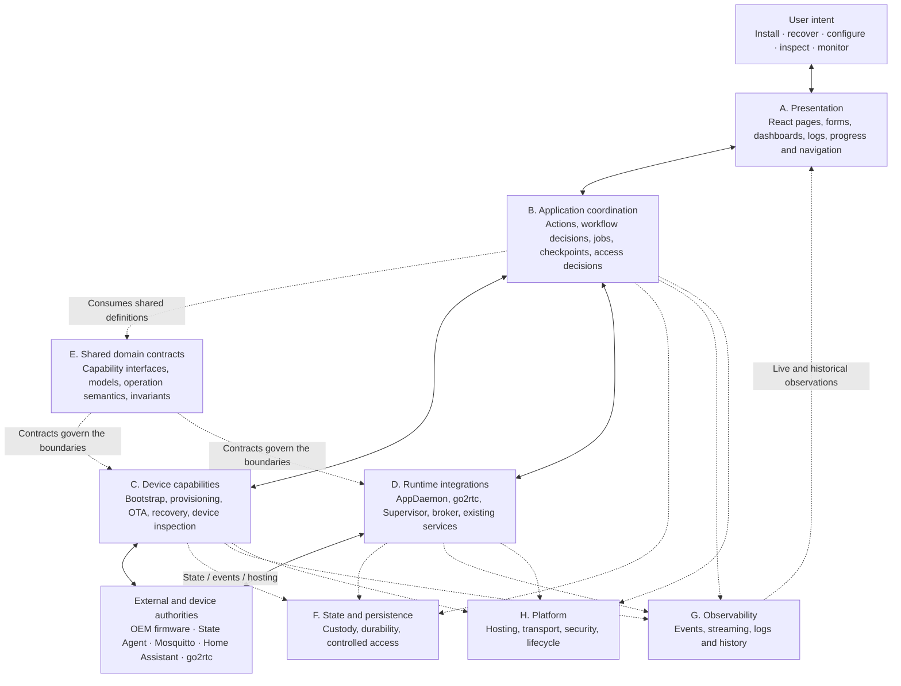
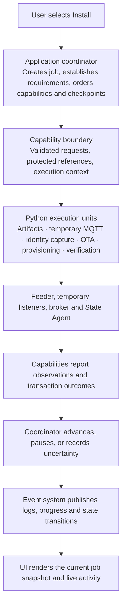
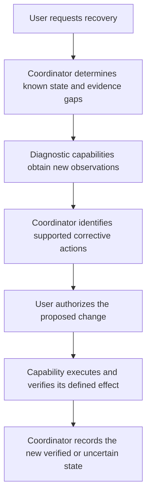
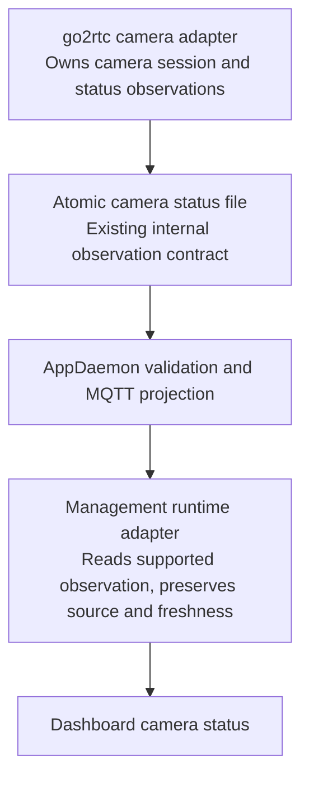
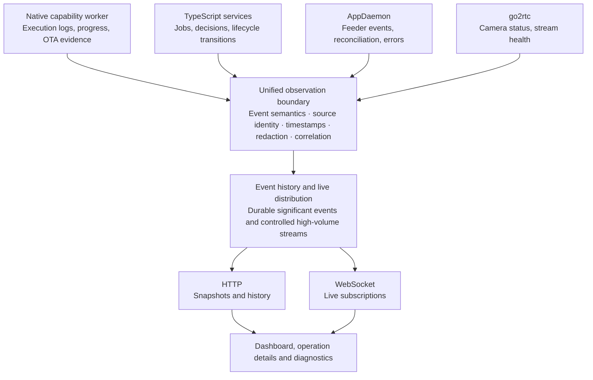
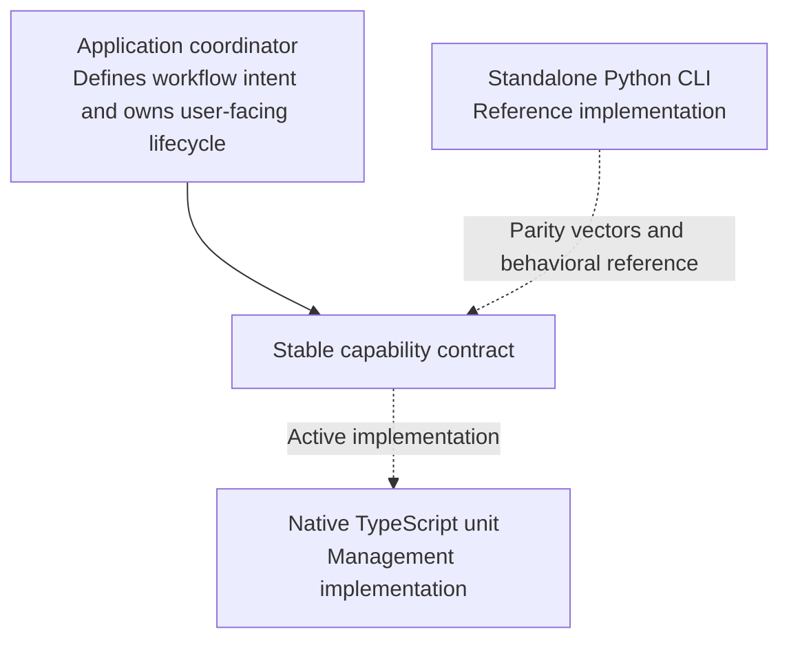

# Petlibro Management — System Coverage, Interaction & Authority Map

> **Capability implementation revision (October 14, 2026):** management
> capabilities target native TypeScript in a separately supervised worker. The
> standalone Python installer remains the functioning reference implementation
> and supported CLI, but it is not imported or executed by management. This
> supersedes older migration diagrams that present Python as management's
> initial active capability implementation.

**Architecture planning · October 13, 2026**  
**Existing implementation:** [Petlibro-Home-Assistant / `develop`](https://github.com/tannerln7/Petlibro-Home-Assistant/tree/develop)  
**Status:** Proposed target architecture and responsibility map, informed by the existing implementation. It is not an implementation specification or a claim that the proposed management application already exists.

---

## 1. The governing architectural model

The architecture should have three clearly distinguishable flows:

- **Intent flows downward:** A user requests an outcome. The application interprets that request, coordinates the necessary capabilities, and delegates execution to the components authorized to perform it.
- **Results and observations flow upward:** Executing components report outcomes, evidence, status changes, progress, and failures. The application interprets and presents those results without changing their meaning.
- **State moves through explicitly controlled boundaries:** Each piece of authoritative state has an identifiable owner. Other components receive validated views, snapshots, references, or events, rather than implicitly sharing ownership.

The important distinction is that **communication does not confer authority**.

A component may be able to read something without being allowed to change it. It may be able to request a change without owning the transaction. It may cache a result without becoming the authoritative source.

These rules should remain true regardless of whether the implementation runs in Python, TypeScript, C, or Go.

### The top-to-bottom system map



*The diagram shows logical responsibility relationships, not a mandated process topology. Contracts are shared definitions, not a service through which every request must pass. Observations from existing runtime services can also flow upward without an active user request.*

The eight architectural regions established earlier remain useful. Keep them, but introduce an explicit distinction inside Region D between the **integration adapter** we own and the **operational service** it communicates with.

For example, an AppDaemon adapter doesn't own feeder truth simply because it exposes that truth to our dashboard.

---

## 2. What the existing implementation establishes

Before assigning authority in the new application, preserve the boundaries that already exist.

The current repository's architecture documents establish several important facts:

| Existing component | Established responsibility |
|---|---|
| **Installer** | One-time OEM provisioning, temporary MQTT capture, bootstrap OTA, payload preparation, final broker restoration |
| **AppDaemon** | Routine feeder control, MQTT commands, State Agent reconciliation, verified persistent writes, HA discovery |
| **State Agent** | Authenticated access to feeder-local persistent state and constrained signed updates |
| **go2rtc** | Camera transport, session handling, media normalization, streaming and camera runtime status |
| **Mosquitto** | MQTT message transport and broker authentication |
| **Home Assistant** | Add-on lifecycle/configuration and published HA entity consumption |
| **OEM firmware** | Actual device behavior, physical operations, firmware state and local persistent files |

These aren't merely organizational labels.

For instance, the existing AppDaemon implementation deliberately refuses to treat a successful MQTT acknowledgment as proof of a persistent feeder-state change. It verifies against a fresh State Agent snapshot. Similarly, go2rtc owns camera transport state rather than expecting AppDaemon to infer the physical camera session's status.

Those behaviors are documented in the existing [architecture](https://github.com/tannerln7/Petlibro-Home-Assistant/blob/develop/docs/architecture.md) and [controller responsibilities](https://github.com/tannerln7/Petlibro-Home-Assistant/blob/develop/addon/appdaemon/README.md).

**Our new architecture should preserve these existing authority boundaries, while making the interfaces to them cleaner and more intentional.**

The mappings below describe target responsibilities; implementation status still belongs in maintained application documentation and tests.

---

## 3. Ownership across the eight architectural regions

Define each region using four questions:

1. What does it define?
2. What does it own throughout its lifecycle?
3. What does it need from other regions?
4. What must it not assume ownership of?

| Region | Defines and owns | Must not own |
|---|---|---|
| **A. Presentation** | UI interaction state, navigation, visualizations, input presentation | Jobs, feeder truth, device sessions, authoritative operation outcomes |
| **B. Coordination** | User-facing actions, workflow progression, application job lifecycles, decisions and checkpoints | Low-level device mechanics, external service internals |
| **C. Device capabilities** | Technical execution, device-operation invariants, live resources and execution evidence | UI navigation, user-facing workflow definitions, unrelated runtime services |
| **D. Runtime integrations** | How the application observes or requests behavior from external operational authorities | The external authority's internal state machine or lifecycle |
| **E. Domain contracts** | Shared types, guarantees, capability boundaries and semantic definitions | Runtime state, network resources or executing operations |
| **F. State and persistence** | Storage mechanisms, custody, durability, retention and controlled access | Authority over information whose source lies elsewhere |
| **G. Observability** | Event formats, delivery, historical event access, progress and log subscriptions | Independent decisions about whether device operations succeeded |
| **H. Platform** | Hosting, process supervision, authenticated entry points, IPC and resource isolation | Business workflow or device-protocol decisions |

There is a fundamental separation between **owning state** and **storing state**.

Region F can store the application coordinator's operation history, but Region B determines what that history means.

Region F can store protected captured credentials, but it does not decide whether those credentials are valid.

Region G can distribute a camera-status event, but go2rtc remains the authority that observed the camera session.

That distinction should guide the rest of the map.

---

## 4. Interaction boundaries: who requests, who executes, who owns the result?

This is the central relationship map. Every connection between architectural regions should have a defined interaction and ownership rule.

| Boundary | Direction of requests | Lifecycle / authority owner | What may cross the boundary |
|---|---|---|---|
| **A ↔ B** Presentation ↔ coordination | UI submits intent; coordinator returns descriptions and outcomes | B owns jobs; A owns visual interaction | Validated inputs, action descriptions, job references, results |
| **B ↔ E** Coordination ↔ contracts | Coordinator consumes established contracts | E defines shared semantics; B applies them | Typed requests, prerequisites, outcomes, capability descriptions |
| **B ↔ C** Coordination ↔ device capabilities | B requests an operation; C executes it | B owns user workflow; C owns device transaction | Operation requests, session references, evidence, progress |
| **B ↔ D** Coordination ↔ runtime integrations | B requests observations or authorized actions | External service retains operational authority | Status, configuration requests, command receipts |
| **C ↔ device** Capabilities ↔ feeder | C initiates supported device operations | C owns the active transaction; firmware owns physical behavior | OEM packets, authenticated requests, observed device responses |
| **D ↔ runtime services** Integration ↔ external authority | Adapter observes or requests behavior | AppDaemon, go2rtc, Supervisor, etc. retain their state | Validated observations and supported commands |
| **B/C/D ↔ F** Services ↔ persistence | State owner requests durable storage or retrieval | Originating subsystem owns meaning; F owns storage integrity | Records, protected references, versioned snapshots |
| **B/C/D ↔ G** Services ↔ observability | Producers publish observations | Producer owns facts; G owns journal/delivery behavior | Logs, lifecycle events, telemetry, progress |
| **A ↔ G** UI ↔ observability | UI subscribes and queries history | G owns delivery; A owns presentation | Event streams, cursors, log excerpts, subscriptions |
| **All ↔ H** Components ↔ platform | Components request platform facilities | H owns process/transport security and supervision | Authenticated sessions, sockets, file access, service health |

A useful rule for any future component is that it should identify its interaction type before crossing a boundary.

| Interaction type | Meaning |
|---|---|
| **Observation** | Read something without assuming authority |
| **Command** | Request an authorized owner to act |
| **Execution** | Carry out a capability-owned operation |
| **Publication** | Expose a controlled snapshot or event |
| **Custody** | Safely store data owned by another subsystem |
| **Authority transfer** | Explicitly hand over exclusive control |

These distinctions become especially important for broker handoff, firmware installation, and the later AppDaemon migration.

### 4.1 Presentation ↔ coordination

**The frontend owns the experience, not the work.**

The UI defines how an action looks, where it appears, and how users interact with its inputs.

The application coordinator defines whether the action exists, what its input means, whether it can run, and what its execution status means.

For example, a `Recover MQTT` action can be displayed from several pages. The UI obtains its requirements from the application, renders those requirements, and submits the user's response.

The application owns the action's lifecycle after submission.

Closing the browser, navigating elsewhere, or collapsing a log viewer must not alter that lifecycle.

The application then exposes a safe operation view containing progress, outstanding user decisions, and supported results.

The UI may cache that view. It does not become authoritative for it.

### 4.2 Coordination ↔ device capabilities

**This is the principal application-to-capability execution boundary.**

The coordinator owns the larger operation from the user's perspective: which capabilities need to run, their ordering, prerequisites, and when user decisions are required.

The capability owns its execution mechanics: resource acquisition, technical validation, device protocol interaction, and proof of its outcome.

For example:

- The coordinator determines that installation requires the feeder's factory MQTT identity before broker credentials can be validated.
- The bootstrap MQTT capability determines how to capture that identity and confirm it belongs to the expected feeder.
- The coordinator determines what happens after identity capture.
- The capability returns the identity through a protected result, along with safe metadata and evidence.

The coordinator must not reach inside the capability to inspect its internal socket, trigger a threading event, or modify an MQTT connection generation.

Conversely, the capability must not render a form or decide which user-facing installation page comes next.

There is an important qualification: a capability may legitimately own an **indivisible technical transaction** spanning several device protocol steps. The coordinator cannot arbitrarily interrupt or reorder those steps.

That isn't duplicated orchestration. It's a distinction between user-workflow coordination and technical transaction integrity.

### 4.3 Coordination ↔ runtime integrations

This boundary looks similar to device capabilities, but its authority model is different.

A capability such as bootstrap OTA is part of our management application and owns the transaction it executes.

An integration such as the AppDaemon adapter communicates with an already-running independent authority.

The adapter must respect that authority.

For routine feeder control, that means the initial dashboard cannot independently modify persistent feeder settings just because it has network access to the feeder.

If we eventually add routine controls to the management application, they should invoke AppDaemon's existing control mechanism, rather than creating a second write coordinator.

When AppDaemon is replaced, its TypeScript successor takes over the same authority. The dashboard should not need to change.

### 4.4 Services ↔ state storage

The state owner defines what must be preserved, how it is interpreted, and when it becomes valid or obsolete.

The persistence region supplies reliable storage, transactions, access control, and retrieval.

For example, the operation manager may record that a bootstrap operation is awaiting operator action. Persistence stores the record, but doesn't independently decide that installation is ready to resume.

Likewise, the worker may store captured credentials securely. The coordinator receives an authorized credential reference rather than treating the worker's secret file contents as ordinary application data.

**The storage location and the authority over the stored information are separate decisions.**

### 4.5 Services ↔ observability

Any subsystem may publish events, but those events must retain their origin and meaning.

An OTA capability can publish that an `OTA_INFORM` report was received. The event system distributes and records it. It must not reinterpret that single observation as proof that the entire installation succeeded.

Similarly, an AppDaemon event reporting `READY` means the controller reached its own verified-ready state. The dashboard should not silently redefine `READY` as merely seeing an MQTT connection.

This establishes one shared observability system without inventing a second source of truth.

---

## 5. The authoritative state map

This is the most important map after the interaction boundaries.

There are several different types of state, and they cannot all be treated as equivalent.

### 5.1 What is authoritative, and where?

| State or information | Authoritative owner | Safe shared representation | Lifetime |
|---|---|---|---|
| User's pending form inputs | Browser until submission | Validated submission to coordinator | UI session |
| Accepted user intent | Application coordinator | Durable action/job record | Job lifetime and history |
| Workflow stage and user checkpoint | Application coordinator | Operation snapshot + events | Job lifetime |
| Active temporary MQTT session | Bootstrap capability | Opaque session ID, health and metadata | Active session |
| Captured factory MQTT credentials | Protected installer credential custody | Redacted identity or authorized secret reference | Until explicitly retired |
| Bootstrap payload and recovery artifacts | Artifact preparation/custody subsystem | Verified artifact reference and metadata | Configured retention |
| OTA command and correlation state | Guarded OTA capability | Evidence, phase and outcome | Transaction and recovery record |
| Physical device behavior | OEM firmware | Observed device messages and checks | Device lifetime |
| OEM persistent configuration | Feeder-local files | State Agent decoded snapshot | Firmware-managed |
| Reconciled feeder settings and plans | AppDaemon controller's verified model, based on State Agent | Read-only verified snapshot and availability | Controller lifecycle |
| Current dispensing state | AppDaemon's ordered live-event model | Fresh operational status with availability | Connection/event lifecycle |
| Camera media session | go2rtc | Validated runtime status and stream metadata | Stream/session lifetime |
| MQTT broker accounts and ACLs | Final broker | Credential test outcome, not assumed configuration | Broker configuration lifetime |
| Add-on options | Home Assistant Supervisor | Validated configuration projection | Add-on installation lifetime |
| Service running/restart status | Process supervisor / relevant service | Service health observation | Service lifecycle |
| Durable semantic event history | Management operation journal | Filtered history and live notifications | Operation/evidence retention policy |
| Raw operational logs | Existing service/worker log producers | Sanitized on-demand subscription records | Browser session; producer-native retention remains independent |
| Dashboard health summary | Derived by management application | Versioned, source-labeled composite view | Cache/observation lifetime |

The reconciled feeder-state row deserves care. The underlying OEM files are the persistent truth; the State Agent supplies a validated view of them. AppDaemon owns the process of reconciling that truth with MQTT commands and deciding which controls can safely be considered available.

In the current implementation, the State Agent's `/v1/core` response explicitly distinguishes persistent state from cached or runtime data. AppDaemon uses fresh revisions and verification, rather than accepting retained Home Assistant values as truth. See [existing state-ownership documentation](https://github.com/tannerln7/Petlibro-Home-Assistant/blob/develop/docs/architecture.md).

### 5.2 Separate five types of state

Use these classifications throughout the architecture.

| Classification | Meaning | Example |
|---|---|---|
| **Authoritative state** | Current truth under an identified owner | Firmware persistent feeding plans |
| **Execution state** | State of a currently running operation | Awaiting OTA result for a particular message ID |
| **Desired state** | A requested or configured target | User wants MQTT redirected to a new broker |
| **Observed state** | Evidence about the world at a particular time | Last heartbeat, camera codec status |
| **Historical state** | Retained record of previous facts or operations | Last completed installation or feed event |

A sixth consideration, **cached state**, is a storage characteristic rather than a separate authority category. A cache can contain a representation of any of these, but it must preserve its source and validity rules.

This prevents several subtle mistakes.

A requested broker destination is not evidence that the feeder adopted it.

A retained last-feeding record is not proof that dispensing is currently in progress.

A successful MQTT connection is not proof that the State Agent is healthy.

A completed OTA download is not proof that the firmware-side installation finished.

### 5.3 State sharing should be intentional

Every shared state view should answer:

- **Source:** Who produced the information?
- **Authority:** Is this authoritative, verified, observed, requested, or historical?
- **Freshness:** When was it last obtained, and is it still valid?
- **Scope:** Which device, operation, or service does it describe?
- **Access:** Who can view it or request changes?
- **Failure semantics:** What does the consumer see when the source becomes unavailable?

Make those properties part of the conceptual contract for shared application state.

Not every UI value needs to visibly display all of that metadata, but the backend should preserve it where it matters.

### 5.4 A deliberate projection layer

The dashboard needs a convenient, coherent device model, even though the underlying data comes from different authorities.

That implies an intentional **application projection**, rather than one giant mutable device object.

For example, a device overview might combine:

| Projection section | Source |
|---|---|
| Identity | Installer + discovery |
| Connectivity | MQTT controller |
| Settings | Verified State Agent state |
| Dispensing | Ordered OEM events |
| Camera | go2rtc status |
| Installation | Management job history |
| Service health | AppDaemon + platform |
| Recent errors | Structured event history |

The management application owns this composite **presentation model**, but not the underlying source facts.

Each field can become stale or unavailable independently. One healthy subsystem must not make the whole device appear healthy.

This projection boundary will be especially valuable during the AppDaemon migration, because the dashboard can keep consuming the same model while its source adapter changes.

---

## 6. Lifecycle ownership: what starts, what survives, and what can be interrupted

Distinguish the lifetime of a user interaction from the lifetimes of application jobs, capability sessions, service processes, and device transactions.

Those lifetimes are not interchangeable.

| Lifecycle | Owner | Created when | Ends when |
|---|---|---|---|
| Browser viewing session | Presentation/access layer | User opens the application | Browser disconnects or session expires |
| User-facing job | Application coordinator | An accepted action is submitted | Workflow reaches a recorded terminal state |
| Capability invocation | Capability implementation | Coordinator invokes the capability | Capability returns a supported outcome |
| Stateful capability session | Capability's resource owner | Resource acquisition is accepted | Resources are safely released or lost |
| Critical device transaction | Executing capability | Transaction crosses its defined commitment boundary | Completion, known failure, or unresolved interruption |
| Native capability worker process | Platform/s6 | Worker service starts | Worker shuts down or crashes |
| Management Node process | Platform/s6 | Management service starts | Service shuts down or crashes |
| AppDaemon controller | Existing AppDaemon/s6 | Operational controller starts | Controller stops or fails |
| Camera session | go2rtc | Media source becomes active | Camera adapter/transport closes the session |
| MQTT broker service | Mosquitto/Supervisor | Broker starts | Broker stops or fails |
| State Agent | Feeder's runit supervisor | Feeder service starts | Device-side service stops or restarts |

### The most important rule

**A parent workflow does not automatically own the lifetime of every resource used by its children.**

For example, the management coordinator owns an installation job. However, the native capability worker owns its active MQTT listener. The actual operating-system process is supervised by s6.

These components cooperate, but each has different responsibilities.

If the browser closes, the coordinator still owns the job.

If Node restarts, Python may still own a live device transaction.

If Python crashes, the application may retain the job record but cannot assume the MQTT session still exists.

If the feeder reboots, neither of those facts alone proves that its OTA transaction succeeded or failed.

### Safe interruption and cancellation

This implies three distinct actions that should never be confused:

- **Dismiss or navigate away:** A frontend-only action. No effect on backend execution.
- **Request cancellation:** A coordinator-level request to stop an operation where doing so is defined as safe. The executing capability determines whether cancellation can be honored.
- **Recover interrupted work:** A new, explicitly evaluated application decision using recorded evidence and current observations. It is not automatically equivalent to resuming the old function at its previous line.

For technical transactions, the executing capability defines interruptibility. The coordinator owns the resulting user-facing recovery choices.

### Resource ownership and exclusivity

Some resources require exclusive control.

| Resource | Owner while active | Contention rule |
|---|---|---|
| Bootstrap MQTT listener | Bootstrap session capability | One owner per bind address/port |
| OTA transaction | Guarded OTA capability | One active device-modifying OTA per feeder |
| Bootstrap HTTP artifact listener | Artifact-delivery capability | Bound to an authorized session and artifact |
| Persistent feeder writes | AppDaemon state coordinator | Management app does not bypass it |
| go2rtc physical camera session | go2rtc camera adapter | Management dashboard observes, doesn't separately control transport |
| Broker start/stop | Supervisor/operator via supported integration | Requires explicit, verified transition |
| Bootstrap credentials and keys | Protected custody subsystem | Access by specific authorized capability, not general UI state |

Resource ownership also needs to be reflected in application scheduling.

The coordinator should know which classes of operations conflict, without needing to know how the worker implements socket locks or device transaction sequencing.

That gives one application-wide view of whether an action can start, while the executing capability retains independent protection against unsafe concurrent calls.

---

## 7. Complete intent-to-result flows

These flows expose relationships that static component diagrams miss.

### Flow 1: Initial feeder installation



The significant authority boundaries within installation are:

| Transition | Authority rule |
|---|---|
| User supplies initial configuration | Application validates intent; capability validates device constraints |
| Artifacts are prepared | Artifact subsystem owns contents, hashes, source provenance and custody |
| Temporary MQTT listener starts | Worker owns active socket and session state |
| Feeder is redirected | Provisioning capability sends the command; observed connection establishes whether it took effect |
| Factory identity is captured | Worker owns raw credential acquisition; protected custody controls access |
| Broker credentials are tested | Broker decides whether authentication is accepted; probe reports the observation |
| OTA starts | Guarded OTA capability exclusively owns the critical technical transaction |
| Payload is delivered | Artifact-delivery capability owns the authorized HTTP transfer |
| Device restarts | Firmware performs the restart; worker observes and correlates the subsequent behavior |
| Final broker handoff occurs | Coordinator manages the overall transition; broker, worker and feeder each retain their own resource authority |
| Add-on configuration changes | Home Assistant's supported configuration mechanism owns the applied settings |
| Routine integration becomes ready | AppDaemon verifies feeder readiness and publishes HA state |

There are two distinct success boundaries here.

**Bootstrap transaction success** is determined from the required device-side evidence.

**End-to-end installation success** is determined by the coordinator, using the bootstrap result plus the required final integration checks.

Do not conflate these.

The current CLI already distinguishes several forms of evidence: OTA PUBACK, payload download, terminal OTA report, post-install startup event, and final broker heartbeat. Its final heartbeat verification can produce a warning without treating the entire bootstrap as failed. That distinction should be represented accurately in the new model. See [existing bootstrap transaction](https://github.com/tannerln7/Petlibro-Home-Assistant/blob/develop/installer/bootstrap.py).

### Flow 2: Recovery or maintenance action

Recovery is not merely a shortened installation workflow.

It may begin with a feeder that is partially installed, unreachable through MQTT, missing expected configuration, or in an uncertain state after interruption.

The application therefore starts with **state discovery and capability assessment**, rather than assuming the normal installation prerequisites still hold.

The flow is:



Recovery shares device capabilities with installation, but it does not necessarily share the same workflow.

The capability defines what it can safely do. The application determines when using it is appropriate.

This is why we shouldn't build one large installer class that implicitly owns every possible recovery scenario.

### Flow 3: Normal dashboard observation

The dashboard is primarily an observation consumer.

For example, consider the camera status display.

The current implementation already provides a useful path:



AppDaemon currently validates the go2rtc status file and publishes a stable MQTT contract. The management app can consume that contract, or a separately defined read-only status interface, without recreating camera-session logic. See [camera metadata publisher](https://github.com/tannerln7/Petlibro-Home-Assistant/blob/develop/addon/appdaemon/src/camera_metadata.py).

The same pattern applies to feeder settings, connectivity and operational telemetry.

The dashboard may aggregate them into one convenient view, but each observation retains its source and validity.

Actual video playback belongs to the media plane, not the management event stream. The dashboard may embed or connect to an authorized go2rtc stream, but the TypeScript event system shouldn't become a video transport.

### Flow 4: Existing Home Assistant controls

This flow is particularly important because **not all intent originates in our management UI**.

A user can already change a feeding schedule through Home Assistant.

The existing path is:

```text
Home Assistant entity
        ↓
MQTT command topic
        ↓
AppDaemon CommandRouter
        ↓
FeederStateCoordinator
        ↓
Fresh State Agent preflight
        ↓
OEM MQTT command
        ↓
Firmware acknowledgment
        ↓
New State Agent revision / snapshot
        ↓
Verified controller state
        ↓
Home Assistant MQTT projection
```

Our new management application must not insert itself into this critical control path merely because it is now present in the same add-on.

It can observe the result and display the relevant state. That leaves the existing controller fully operational even if the management web application is unavailable.

When AppDaemon is eventually ported, the TypeScript feeder controller replaces that operational path—not the dashboard.

### Flow 5: Diagnostics and updates

Diagnostics can cross several authority boundaries without necessarily changing anything.

For example, a complete feeder health report may collect:

- AppDaemon reconciliation and MQTT status.
- State Agent health, version and revisions.
- go2rtc camera-session status.
- Broker reachability and credential checks.
- Add-on service health.
- Installation artifacts and previous operation results.

The diagnostics region defines the report structure and evaluates the supplied observations. Each source remains responsible for its own data.

State Agent updates require a stronger boundary.

Today, AppDaemon's `state_agent_updates.py` manages signed update acquisition and execution, while the State Agent and its runit supervisor enforce device-side verification, activation and rollback. The management dashboard should initially observe or request that established update mechanism, not create a competing update path.

The source confirms that the State Agent is a narrowly constrained C service, not a general-purpose remote command or filesystem interface. See [State Agent contract](https://github.com/tannerln7/Petlibro-Home-Assistant/blob/develop/state-agent/README.md).

---

## 8. Observability: one upward-facing information system

Logs, progress, telemetry and diagnostic events should share common semantics regardless of their source language.

Make the architectural boundary precise:

**Every producer publishes observations about what it owns. The observability region makes those observations accessible. It does not take over the producer's state or lifecycle.**



### Different data deserves different guarantees

| Information | Delivery expectation | Durability |
|---|---|---|
| Job accepted, completed or interrupted | Reliable, recoverable | Durable |
| Critical OTA and verification evidence | Reliable, ordered within the relevant transaction | Durable |
| Operator checkpoint or required decision | Recoverable as application state | Durable |
| Build stdout/stderr | Streamed on demand, bounded and correlated | Browser session; critical outcomes/evidence recorded separately |
| Capability progress | Live with current progress snapshot | Latest state recoverable |
| Runtime telemetry | Live or appropriately sampled | Optional historical retention |
| Debug traces | Explicitly subscribed, bounded and redacted | Browser session only unless promoted to a significant semantic event |

A lost WebSocket connection should never mean a lost installation result. It
may mean that ephemeral raw lines were not observed; the operation must remain
understandable from durable semantic state and evidence.

Likewise, if the frontend misses several progress events, it should be able to obtain the latest operation state without replaying every intermediate progress update.

This also enables a simple collapsible execution-details panel. It subscribes to the same operation as the progress indicator, just displaying different event types.

### The Python/TypeScript migration benefit

A worker capability reports through its IPC event adapter. An application-local capability reports through the native application event publisher. Both use the same semantic event contract.

Both produce the same observable contract.

The frontend doesn't need to identify which implementation generated the event, except when presenting source information for diagnostics.

For the later AppDaemon migration, the same rule applies. The operational controller remains the event producer, while its implementation language can change independently.

---

## 9. Where requirements are defined versus enforced

Some regions define what must happen, while others implement or consume that definition.

Formalize the ownership of requirements like this:

| Requirement | Definitive source | Other regions' responsibilities |
|---|---|---|
| Device protocol constraints | OEM behavior and validated protocol contract | Capabilities enforce; coordinator accounts for constraints |
| Capability prerequisites | Capability contract | Coordinator obtains inputs and schedules execution |
| User-facing action requirements | Application action definition | Frontend renders; backend validates |
| Workflow ordering and checkpoints | Application coordinator | UI displays; capabilities return supporting results |
| Technical transaction ordering | Executing capability | Coordinator respects its atomic/interruptibility boundaries |
| Shared data semantics | Domain contracts | Producers and consumers conform |
| State authority and freshness | Original state owner and shared contract | Projections preserve metadata and validity |
| Persistence and secret-handling guarantees | State/custody boundary and security policy | Every producer and consumer complies |
| Event semantics | Observability contract | Producers publish; frontend interprets |
| Runtime security and lifecycle | Platform policy | Components operate within permitted access and restart constraints |

The main goal is to avoid two independent definitions of one rule.

For example, suppose a future device capability exposes a prerequisite that requires an existing bootstrap MQTT session.

That requirement originates in the capability contract. The coordinator accounts for it before offering the action, and the capability still validates its real session state before execution.

Those are complementary responsibilities.

The frontend should not independently invent a rule that an MQTT session is valid because some locally stored boolean says it is.

### Requirements also have different authority

There's a hierarchy:

1. **Physical and protocol constraints:** Determined by the actual feeder, firmware and validated integration behavior. Our application cannot redefine them.
2. **Capability safety constraints:** Define what is required before and during a particular operation, including authorization, resource ownership and evidence.
3. **Application workflow requirements:** Define what the user wants to accomplish, which capabilities are needed, and what choices or confirmations the user must provide.
4. **Presentation requirements:** Define how the user understands, enters, navigates and observes those workflows.

Lower-level device and safety constraints must not be weakened by convenience at higher layers.

But lower layers also shouldn't dictate user-interface structure when they don't have a real technical reason to.

---

## 10. Three relationships that deserve special attention

The coverage map exposes a few boundaries that will influence the architecture more than their apparent size suggests.

### 10.1 Device identity and discovery

Identity information currently appears in several contexts: the installer's captured credentials and configured feeder IP, AppDaemon's serial/UID-based discovery, its device registry, and go2rtc's resolved camera streams.

The existing `device_discovery.py` maintains a private device registry, including serial, UID, network address, stream name, and readiness information.

The new application will also need a device registry for installation history and device selection.

**Do not create two competing authorities for the same dynamic device identity information.**

Separate it conceptually:

| Information | Initial authority |
|---|---|
| Installer's intended target | Installation job |
| Factory MQTT identity | Captured device identity and protected credential record |
| Current operational discovery | Existing AppDaemon discovery |
| Current camera association | Existing go2rtc/discovery relationship |
| Management's historical device record | Management device registry |

The management registry becomes an index associating those records, not an independent detector of whichever IP happens to be current.

The device model should accommodate multiple devices as identities, while respecting that the current guided installer explicitly supports one feeder per add-on deployment and binds the State Agent token to a specific feeder/HA address pair.

Do not silently expand that supported installation scope merely because the UI has a Devices page.

### 10.2 Add-on configuration and startup

This boundary has more consequences than it first appears.

The current add-on loads Home Assistant options from `/data/options.json` and renders AppDaemon/go2rtc configuration through `render_config.py`.

Its s6 service scripts use that renderer as part of startup.

The new application must be available in situations where the feeder has not yet been installed and operational configuration may not be complete.

That leads to a firm architectural requirement:

**The management interface's availability cannot depend on successful initialization of AppDaemon, go2rtc, the MQTT broker, or a configured feeder.**

It must remain accessible to explain and recover from those failures.

The platform owns startup and supervision. The management application owns the presentation and coordination of remediation. Existing configuration renderers own their current supported output behavior until explicitly migrated.

Similarly, changing an add-on option and observing that the new configuration took effect are different events.

A defined application-to-platform boundary is needed for applying configuration and establishing whether the relevant service actually adopted it.

### 10.3 Broker handoff is a transfer of resource ownership

Most interactions can be expressed as a command or observation.

The installation-time MQTT broker transition is different.

The final broker and temporary listener cannot simultaneously own the same address/port.

The application coordinator must therefore orchestrate a controlled ownership transition between independent actors:

- Mosquitto, which owns the final broker service.
- The Python bootstrap session, which owns its temporary listener.
- The feeder, which independently controls where it attempts to connect.
- AppDaemon, which depends on the final broker during routine operation.
- Home Assistant, which may have unrelated MQTT clients affected by broker downtime.

The current CLI uses a separate setup machine to avoid this conflict. Its requirement to validate final broker credentials before OTA remains important.

Our target architecture must support the same-host scenario without accidentally losing that guarantee.

This deserves its own interaction and interruption analysis, but not necessarily its own large backend subsystem.

---

## 11. Future migration boundaries

Now that authority is mapped, independently migratable units can be placed within it.

The key requirement is:

**A migration replaces the implementation of an authority-preserving capability or operational service. It must not implicitly transfer responsibilities to unrelated components.**

### Installer capability migration



*One implementation owns an active device resource at a time. The independent CLI and management implementation may coexist on disk and in tests, but must not acquire competing live sessions.*

A migration unit includes its private dependency closure.

Pure behavior can exist independently in both languages with shared parity vectors.

Stateful shared dependencies require explicit ownership, and tightly coupled technical transactions may migrate as a group.

For example, our current temporary MQTT server and OTA transaction have strong live-session dependencies. They can be internally modular while remaining one coordinated migration group.

The application workflow depends only on the stable capability contract.

### AppDaemon migration

AppDaemon's migration is similar, but involves a larger continuous operational authority.

The existing controller already has meaningful internal boundaries around MQTT transport, protocol handling, State Agent reconciliation, persistent writes, telemetry, discovery, Home Assistant presentation and updates.

Preserve those as conceptual units without assuming they all need to migrate simultaneously.

However, some share tightly coupled live state. In particular, the persistent-write coordinator, MQTT command acknowledgments and authoritative State Agent verification have to retain consistent operation ordering.

This makes the **routine feeder controller** an important authority boundary even if its internal components migrate separately.

During the transition:

- AppDaemon remains the active routine-control authority.
- New TypeScript components may provide passive observations, shared protocol implementations, tests, or capabilities that don't create competing writers.
- The final routine-control authority changes only through an explicit, verified cutover.
- go2rtc remains independent of that cutover.

The frontend's interaction and state contracts remain unchanged.

That allows modular migration without turning the dashboard into the controller.

---

## 12. Coverage audit: have we accounted for the whole application?

Use this as the current architectural coverage checklist. It identifies the major areas and the next definition each requires.

*These are areas for future detailed review, not a record that the work has been completed.*

- [ ] **Presentation and navigation** — Page responsibilities, reusable components, action presentation. **Boundary:** A ↔ B.
- [ ] **Action and workflow coordination** — Prerequisites, user checkpoints, execution lifecycles, conflict rules. **Boundary:** B ↔ C/D.
- [ ] **Device capability system** — Migration units, private/shared dependencies, resource ownership. **Boundary:** B ↔ C.
- [ ] **Python execution worker** — Execution sessions, technical transaction boundaries, safe interruption. **Boundary:** C ↔ H/F/G.
- [ ] **Routine controller integration** — AppDaemon authority, observation interfaces, future cutover. **Boundary:** D ↔ B/E.
- [ ] **Camera/media integration** — go2rtc observations, playback versus management responsibilities. **Boundary:** D ↔ A/G.
- [ ] **Home Assistant integration** — Options, supervision, Ingress, standalone access, service state. **Boundary:** D/H ↔ B.
- [ ] **Identity and configuration** — Device associations, protected credentials, configuration authority. **Boundary:** E/F ↔ B/C/D.
- [ ] **Persistent application state** — Job state, artifacts, durable evidence, retention and recovery. **Boundary:** F ↔ B/C.
- [ ] **Observability and diagnostics** — Unified events, logs, telemetry, replay, diagnostics and progress. **Boundary:** G ↔ A/B/C/D.
- [ ] **Security and trust** — Authentication, authorization, network exposure, secret custody. **Boundary:** H ↔ all.
- [ ] **Lifecycle and fault recovery** — Process restarts, transaction interruption, resource transfers. **Boundary:** B/C/F/H.
- [ ] **Migration compatibility** — Contracts, single-owner guarantees and implementation replacement. **Boundary:** E ↔ C/D.

These are not implementation tasks yet. They are the areas whose relationships need to be understood before we can confidently group implementation work.

A few especially important open design questions have emerged from the map:

| Open architectural question | Why it matters |
|---|---|
| How should management jobs relate to worker-held device sessions across restarts? | Determines safe recovery and migration boundaries |
| What constitutes a shared device identity versus an observation from one source? | Prevents duplicate or contradictory device registries |
| How will the add-on remain manageable before AppDaemon can start successfully? | Determines initial installation and recovery availability |
| How will broker ownership transfer safely on the same host? | Preserves existing OTA and credential-validation guarantees |
| What is the authoritative path for applying and confirming add-on configuration changes? | Avoids competing configuration systems and unsafe restarts |
| What is the stable observational contract for the future routine controller? | Allows AppDaemon to migrate independently of the dashboard |
| Which operational events require durable proof versus live-only delivery? | Prevents losing important results while controlling log volume |

These are design questions within established regions, not missing regions that require new subsystems.

---

## 13. The resulting architectural foundation

There is now a consistent model from the user down to the feeder and back.

### Downward: requested change

**User intent → Application action → Workflow coordination → Capability or existing authority → External effect**

### Upward: observed result

**External observation → Executing owner → Validated result/evidence → Application state → Frontend presentation**

### Across: controlled state sharing

**Authoritative owner → Versioned observation or protected reference → Authorized consumer**

### Across: live and historical visibility

**Event producer → Common event contract → Journal/stream → Dashboard or diagnostic consumer**

The architecture's main invariant is:

**An architectural boundary may delegate execution, expose observations, persist information, or transfer authority—but those are different operations with different lifecycle and ownership rules.**

That single distinction resolves many of the problems we're trying to avoid.

The frontend can become sophisticated without becoming a controller.

The coordinator can manage complex installation and recovery workflows without understanding MQTT packet handling.

The native worker can be decomposed into independently replaceable capability groups without needing to understand TanStack Start.

AppDaemon can continue to operate independently until its TypeScript replacement is ready.

And all of them can share observations through one consistent event model without creating a second authority over the actual feeder.

### Where to go from here

Treat this as the **initial complete coverage map** and work through the highest-coupling relationships in more detail—particularly application coordination, capability ownership, resource/session lifecycles, and the existing operational services.

Those boundaries determine what the rest of the application can safely depend on.

Once they're sufficiently defined, the internal design of individual regions becomes much less ambiguous, and the eventual Codex migration groups should emerge naturally from their dependency and authority relationships.

The result is a clearer picture of not just which components will exist, but **why each exists, what it must provide, what it must consume, and what it must never independently own.**
