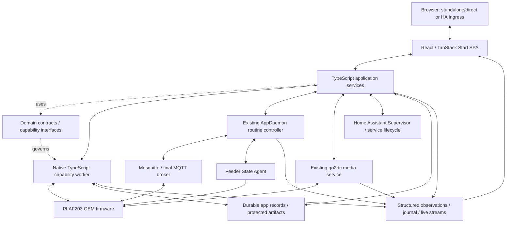

# Petlibro Management — Implementation Guide & Subsystem Specification

**Planning baseline:** October 13, 2026  
**Status:** Maintained target specification with implementation-status notes; tests and source remain the authority for completed behavior
**Existing system:** [Petlibro-Home-Assistant (`develop`)](https://github.com/tannerln7/Petlibro-Home-Assistant/tree/develop)  
**Related planning documents:** [System Coverage, Interaction & Authority Map](petlibro-management-architecture-coverage-map.md) · [Migration & Implementation Sequence](petlibro-management-migration-implementation-sequence.md)

> **Revised capability decision (October 14, 2026).** Management device
> capabilities are implemented natively in TypeScript in an independently
> supervised worker. The standalone Python installer remains supported and is
> the behavioral reference, but management neither imports nor executes it.
> This decision supersedes older Python-extraction language below wherever any
> residual wording conflicts.

> **Purpose.** This document translates the responsibility/authority map and migration sequence into concrete expectations for the planned implementation: technologies, application pages, interactions, service responsibilities, architectural boundaries, code organization, lifecycle and data contracts, migration requirements, security, and validation. It is an engineering reference for future design decisions and bounded Codex implementation assignments. It is **not** a mandate to create every example class, directory, or endpoint literally.

## 0. How to interpret this document

### 0.1 Relationship to the other documents

The three documents serve different purposes and should be maintained together:

| Document | Primary question answered | Authority |
|---|---|---|
| **System Coverage, Interaction & Authority Map** | What exists, who owns it, and how do intent, results, and state move? | Architectural responsibilities and ownership |
| **Migration & Implementation Sequence** | In what dependency order should existing migration, supporting infrastructure, and new features be built? | Workstreams, waves, synchronization gates, migration planning |
| **Implementation Guide (this document)** | What must each subsystem provide, which technologies and conventions should it use, and how will we know it works? | Implementation expectations and engineering acceptance criteria |

If two documents conflict, **do not silently choose the most convenient interpretation**. Record the discrepancy, determine whether ownership/contract or implementation guidance needs adjustment, and update the relevant document(s). Existing device behavior and proved safety invariants take precedence over a speculative design assumption.

### 0.2 Decision status legend

- **Established** — explicitly agreed architectural direction or an already observed invariant of the existing implementation.
- **Planned** — selected target design for implementation, not yet demonstrated in the production environment.
- **Candidate** — preferred implementation detail subject to an explicit evaluation and decision.
- **Requires validation** — a material uncertainty that must be tested before dependent work treats it as fact.
- **Deferred implementation, defined boundary** — future work, including native TypeScript capability ports and the AppDaemon migration, that must be accommodated now but need not be built now.

These statuses distinguish **design completeness** from **implementation completion**. A complete architectural plan may include unresolved questions, provided their ownership, decision criteria, and dependent work are explicit. Do not replace uncertainty with an unsupported assumption.

### 0.3 Governing principles — established

1. **Design toward the complete intended application.** No throwaway MVP architecture or indefinite “we'll add the missing lifecycle/security/state layer later” promises. Incremental construction is appropriate; incomplete underlying contracts are not.
2. **Intent descends, results ascend, authoritative state remains with its owner.** Reading, storing, publishing, commanding, executing, and transferring authority are distinct interactions.
3. **Design capabilities around cohesive responsibility and dependency closure, not files or language boundaries.** A migration unit includes its private dependent implementation. Shared pure dependencies may temporarily exist in Python and TypeScript; exclusive stateful owners may not compete.
4. **Management capabilities are native TypeScript behind language-neutral contracts.** The standalone Python CLI remains an independent installer and behavioral reference. No management process imports or executes it, and no browser contract depends on implementation mechanics.
5. **AppDaemon remains the active routine feeder controller in the initial product.** The future TypeScript routine controller has a planned, independent boundary. The web dashboard does not become a competing controller.
6. **Go camera code and feeder-resident C State Agent remain distinct components.** This project does not imply rewriting go2rtc, the device firmware, or the State Agent in TypeScript.
7. **A single shared event vocabulary, not necessarily a single wire transport.** Structured logs, progress, status, diagnostics, and telemetry are interoperable across source languages and delivered over suitable transports.
8. **Normal web application first; Home Assistant Ingress is the default deployment access mode.** The same build must be compatible with a direct, appropriately authenticated browser entry point.
9. **Favor conventional backend engineering in TypeScript:** cohesive classes, explicit interfaces, encapsulated state, compositional service boundaries, descriptive names, and strongly typed domain models. Do not make the server read like a large collection of React hooks and loosely related callbacks.
10. **Correctness and operator safety take priority over UX convenience.** Do not infer success from a transmitted command, silently duplicate critical operations, fabricate progress, bypass verified state, or escalate permissions to work around misconfiguration.

---

## 1. Target system and technology stack

### 1.1 Deployment shape

The deliverable is **one integrated Home Assistant add-on** with a web management application alongside the existing independently supervised services. Development can take place in a separate migration repository while the existing repository remains a working behavioral reference.



This is a logical diagram. **Contract definitions do not need to be a running process**; the broker is not moved into Node; streaming video is not forwarded through the event journal; and not every arrow represents an unrestricted direct network connection.

### 1.2 Selected and candidate technologies

| Area | Selection | Status and rationale |
|---|---|---|
| Application language | **TypeScript**, strict configuration | **Established.** Browser application and new server application use TypeScript. |
| UI | **React** | **Established.** Reusable page, layout, and operation components. |
| Web framework | **TanStack Start**, SPA mode | **Planned selection.** Normal browser app with server features but no dependency on per-request SSR of the dashboard. |
| Navigation | **TanStack Router** | **Planned selection.** Typed client navigation and nested layouts. |
| Server data | **TanStack Query** | **Planned selection.** Query snapshots and cache updates driven by live events. |
| Components | **shadcn/ui + Tailwind CSS** | **Planned selection.** Coherent, accessible, customizable UI. |
| Dynamic forms | **RJSF (`react-jsonschema-form`) with `@rjsf/shadcn`** | **Planned selection.** Render action-specific fields using shared schemas; customize higher-level layouts. |
| Schema/validation | **Typed runtime schemas**, with Zod as the preferred TypeScript authoring layer | **Candidate for exact library/JSON Schema generation path.** Must prove correct RJSF/AJV conversion and server enforcement, including optional/conditional/secret fields. |
| Tables | **TanStack Table** | **Planned selection.** Device lists, history, operation/event tables. |
| Virtualized streams/lists | **TanStack Virtual** | **Planned selection.** Efficient bounded log/event rendering. |
| Charts | **TanStack Charts** as the preferred initial charting evaluation | **Candidate pending application-specific fit** for telemetry, responsive sizes, and efficient updates. Do not treat a specific chart API/version as frozen until tested. |
| Motion | **Motion** where useful | **Optional.** Respect reduced-motion preferences; never obscure operation state. |
| Icons | **Lucide** | **Planned selection.** Consistent small UI iconography. |
| Production host-side runtime | **Node.js 24** | **Planned selection; scaffolded and host-build validated.** One production application build, no Vite development server in the add-on. Image/runtime compatibility still requires packaging validation. |
| Device operations worker | **Native strict TypeScript on Node.js 24** | **Established and implemented foundation.** Independently built/supervised from the web process; the standalone Python installer remains the reference, not a runtime dependency. |
| Worker RPC | **HTTP/JSON over a Unix domain socket** | **Implemented foundation.** Private mode-`0600` socket, versioned health/capability/invocation routes, durable invocation snapshots and bounded event replay are packaged. |
| Browser live updates | **WebSocket support** plus HTTP snapshots/history | **Implemented foundation; authentication/Ingress validation pending.** Notifications reconnect by durable cursor; snapshots/history remain recovery truth. |
| Durable application records | **SQLite under persistent add-on storage** | **Selected and implemented for operation snapshots/events.** Node 24 built-in SQLite, schema versioning and transactional event/state writes are validated; add-on backup/restore and production concurrency remain to qualify. |
| Process supervision | **s6** services | **Established existing pattern**, expanded for management and worker. |
| Testing | **Vitest, Playwright, Python pytest/unittest, existing C/Go tests** | **Planned baseline.** Contract, integration, and system-level tests must complement unit tests. |
| Build/package manager | **npm with committed lockfile; mise-managed Node** | **Established for the management scaffold.** Do not mix package managers. |

Framework reference links: [TanStack Start SPA mode](https://tanstack.com/start/latest/docs/framework/react/guide/spa-mode), [server functions](https://tanstack.com/start/latest/docs/framework/react/guide/server-functions), [server routes](https://tanstack.com/start/latest/docs/framework/react/guide/server-routes), [Node/Docker hosting](https://tanstack.com/start/latest/docs/framework/react/guide/hosting), [RJSF shadcn theme](https://rjsf-team.github.io/react-jsonschema-form/docs/usage/themes/), [TanStack Charts](https://tanstack.com/charts/latest/docs/overview).

**Important:** TanStack Start's SPA mode does not mean a static-only deployment. We still require server functions/routes, long-running operation services, process supervision, persistence, and streaming in the add-on. A production Node runtime remains part of the architecture.

### 1.3 Technology ownership rules

- React components must not instantiate capability clients, open raw OEM sockets, or contain broker/State Agent command logic.
- TanStack-specific server functions/routes are **adapters** around ordinary TypeScript application services; domain behavior must remain usable independently of TanStack Start.
- TypeScript application services depend on domain contracts, not worker internals or frontend hooks.
- Native capability modules preserve the standalone installer's tested behavior through shared vectors and parity tests without importing or executing Python.
- State Agent, go2rtc, Supervisor, and AppDaemon APIs are existing authority boundaries; new adapters are not permitted to redefine their semantics.
- Pure value models and schema definitions should be shared where meaningful. Do not create an unnecessary generic shared utility framework just to eliminate two small independent functions.

---

## 2. Frontend: application structure and design requirements

### 2.1 Primary UI goals

The management frontend is a **fully functioning browser application** with Home Assistant Ingress as its default access path. It must be coherent both when a feeder is already working and when the system is unconfigured or broken.

Priorities:

1. **Clear information architecture:** overview, devices, installation, actions, operations, diagnostics, logs, history, and settings remain distinct destinations with reusable content/components.
2. **A polished, restrained technical UI:** consistent typography, spacing, light/dark themes, appropriate density, helpful status visualization, and low visual noise.
3. **Progressive disclosure:** show the status and action the user needs first; allow expert expansion for raw evidence, detailed logs, protocol metadata, and underlying observations.
4. **No fake health or fake progress:** exact source, staleness, confidence, and indeterminate outcomes are available where relevant.
5. **Continuous operations survive browser navigation:** the UI is a view of existing server-managed work, never the process controlling it.
6. **Accessible interactions:** keyboard support, focus management, semantic controls, predictable validation/errors, reduced-motion support, readable contrast.
7. **Responsive viewing:** desktop primary, with viable narrower-screen and embedded Home Assistant usage. No assumption of unrestricted viewport width or top-level navigation ownership.
8. **Direct-browser parity:** no duplicated frontend, ingress-only routes, HA-specific component assumptions, or hardcoded root path.

The UI's exact colors, typography scale, sidebar dimensions, and icon placement are **design-system work**, not yet irrevocably chosen by these planning documents. Codex should apply a consistent visual system and maintain a small design token surface; it must not invent multiple disconnected visual styles for different pages.

### 2.2 Proposed application shell

- Persistent navigation appropriate to available width: desktop sidebar and compact/mobile navigation.
- Global context: current installation/device, active operation count, important service warnings, connection state, access/authentication context.
- Every page has a clear title, contextual summary, primary action(s) only when warranted, and a consistent location for warnings/errors.
- Server disconnections are shown independently from feeder disconnections. A WebSocket reconnect must not make an offline feeder appear online.
- Global notifications report durable results or actionable changes, not raw flood-prone telemetry.
- Deep links to a device, operation, diagnostic report, or settings section work through the configured base path.
- View state (selected tab, expanded panels, log filter, table sorting) is local or URL-addressable as appropriate and cannot modify device authority.

### 2.3 Pages and detailed functional requirements

#### Overview (`/` or equivalent)

**Purpose:** the landing dashboard for ongoing operation and rapid problem identification.

**Content:** known device summary, feeder/controller/MQTT/State Agent/camera health, latest significant activity, active operations, unresolved warnings, important update/recovery indicators. Aggregate status should explain which underlying checks it summarizes.

**Actions:** navigate to a device, initiate appropriate maintenance or diagnosis, inspect operation details, open setup if unconfigured. Avoid turning Overview into a duplicate installation wizard or raw MQTT console.

**Sources:** management device projection, active/historical jobs, runtime adapter observations, structured events. A missing observation is *unknown/unavailable*, not success.

#### Devices (`/devices`)

**Purpose:** device identity and lifecycle discovery, not a competing runtime discovery authority.

**Content:** linked serial/product identity, current observed IP, discovery source and freshness, setup status, operational readiness, camera association, quick links.

**Actions:** inspect device details, initiate supported install/recovery, request refreshed observation through an authorized adapter where supported. Distinguish a historical device record from an online device.

**Scope caution:** the existing guided production installer supports **one feeder per add-on deployment** and binds a State Agent token to a feeder/Home Assistant address pair. The frontend may use a list-oriented model without claiming multi-feeder guided installation is already supported.

#### Device details (`/devices/:id`)

**Purpose:** coherent source-aware view of one feeder.

**Content:** identity, firmware/software versions when verified, MQTT and State Agent condition, readiness and last seen, settings/plans as read-only projections initially, current dispensing availability and historical feed observations, camera stream configuration/status, recent warnings and relevant operations.

**Actions:** open targeted diagnostics or authorized maintenance operations; navigate to detailed camera or existing Home Assistant controls. Future direct routine controls must use the routine controller's authorized command contract, never bypass reconciliation.

**Semantics:** label cached, observed, verified, historical, and unavailable values. Do not use retained MQTT state as an authoritative persistent feeder snapshot.

#### Installation / Setup (`/setup`)

**Purpose:** complete initial bootstrap from inside the add-on, with all original safety constraints.

**Capabilities represented:** environment preflight; feeder/network selection; MQTT and host configuration; SSH recovery key selection/generation; artifact preparation; temporary broker readiness; factory MQTT identity capture; final-broker account checkpoint and verification; guarded OTA; reboot and final broker handoff; State Agent integration; add-on configuration; AppDaemon/camera readiness; completion evidence.

**Interaction requirements:**

- Show current verified stage, prerequisites, explanatory notes, user decisions, and active execution state.
- Present high-risk or disruptive actions with explicit, contextual warnings and meaningful confirmation.
- Every long-running step can show stage progress plus collapsible execution details/logs.
- Operator checkpoints are durable and recover after browser closure/refresh.
- Safe stop, blocked, failed, partially verified, and indeterminate outcomes must be distinct.
- Do not imply any step can be resumed automatically unless its technical capability explicitly supports safe resumption.
- Allow installation to proceed with a previously prepared artifact/identity where verified and policy permits; never silently reuse mismatched token/device bindings.
- The normal path completes without needing a separate Linux setup machine or manually invoking the old CLI.

**Critical distinction:** the coordinator owns the **user installation workflow**; the bootstrap capability owns indivisible **technical transaction internals** such as correlated OTA and session generations.

#### Actions / Maintenance (`/actions`)

**Purpose:** discover and run reusable capabilities outside the initial guided installation.

**Content:** actions grouped by outcome, supported device/state applicability, risk level, required inputs, current availability and conflicts. Avoid a generic arbitrary shell command/action runner.

**Actions:** install/provision/recover, inspect, verify, update-check, diagnostics, and other explicitly supported functions. The exact inventory is derived from real capability implementations and existing authority contracts; do not invent unimplemented buttons.

**Presentation:** schemas define fields/validation; designed layouts can group fields and show rich explanations. Both this page and contextual device actions invoke the **same** application action definition.

#### Operations (`/operations`, `/operations/:id`)

**Purpose:** authoritative user-facing view of current and historical jobs.

**Content:** state, phases, timestamps, active capability, resources/checkpoints, percentage only if measurable, current status, outcome, warnings, evidence, retries/interruptions, logs, result metadata, parent/child relationships if meaningful.

**Interactions:** follow live updates, inspect/replay logs, filter/search history, respond to a checkpoint, request allowed cancellation, copy/export redacted diagnostics, navigate away and return without disrupting execution.

**Special behavior:** loss of browser connection merely affects the view. If the worker dies, the job reflects *interrupted/indeterminate* as applicable, not a fabricated success or an unconditional retry.

#### Diagnostics (`/diagnostics` and contextual device diagnostics)

**Purpose:** explain what works, what does not, and why, using reproducible, source-identified checks.

**Content:** categorized tests for LAN/device identity, broker, AppDaemon reconciliation, State Agent, go2rtc/media, service health, configuration validity, artifact provenance, and relevant operations.

**Interaction:** select targeted checks or supported diagnostic bundles, view observed values/timestamps/source/expected meaning, open detailed evidence, export a redacted report. Read-only diagnostics should be the default; modifying diagnostics must be separately named actions.

**Semantics:** diagnostic inference is separate from observed fact and cannot override the authoritative source.

#### Logs (`/logs`)

**Purpose:** inspect all relevant available application and operational logs through one consistent experience.

**Content:** source selector (management, worker, AppDaemon, go2rtc where accessible), severity, time range, operation/device correlation, search, pausing display, auto-follow, bounded history and redacted export.

**Implementation:** virtualized viewer; no unbounded browser arrays; no requirement that a log panel remain open to retain important logs. Distinguish subprocess stdout/stderr from structured semantic events.

#### Events / History (`/history`)

**Purpose:** significant operations and observed changes over time, not another raw log view.

**Content:** installs, recoveries, service changes, update results, verified state changes, device connectivity history where recorded, lifecycle interruptions, warnings, event provenance and correlation.

**Retention:** comply with configured retention and event classes. Historical observations must not be presented as current actuator state.

#### Settings (`/settings`)

**Purpose:** manage explicitly owned application settings and present supported integration configuration.

**Content:** management preferences, diagnostics/logging configuration, optional network/browser exposure policy, credential/artifact/key custody, relevant add-on options and integration settings, versions/compatibility metadata.

**Authority:** Home Assistant Supervisor owns add-on options. Existing runtime config is rendered by the established renderer until formally migrated. Changes must pass through a supported, permission-checked integration and show whether the affected service adopted them. Directly editing `/data/options.json` is not assumed to be safe or supported.

#### Cross-page supporting views

Include appropriate not-found/access-denied/offline/initializing/degraded states, first-use guidance, blocked-operation and recovery dialogs, and optional authenticated advanced detail views. These should reuse established components rather than creating new page frameworks.

### 2.4 Shared frontend components

| Component family | Responsibility | Required characteristics |
|---|---|---|
| `ApplicationShell` | Layout/navigation/context | Root and prefixed routing, responsive, theme-consistent |
| `ActionForm` | Schema-based inputs | RJSF, field grouping, validation, contextual help, secret masking |
| `ActionConfirmation` | Risk/impact confirmation | Explicit consequences, no ambiguous confirmations |
| `OperationProgress` | Active stage and overall operation progress | Determinate or indeterminate, verified source of percentage |
| `OperationDetails` | Expandable per-operation detail | Collapsible stream/logs, no effect on execution when closed |
| `OperationCheckpoint` | Required user action | Restorable from job snapshot, response validation |
| `OperationResult` | Final/uncertain result | Clear evidence and warnings, actionable follow-ups |
| `ServiceHealth` / `StatusSummary` | Source-aware health | Distinguishes status, availability, freshness, source |
| `LogViewer` | Live/historical log experience | Virtualized, filter/search, follow/pause, redacted exports |
| `DiagnosticResults` | Check/report display | Evidence versus inference, source and time visible |
| `DeviceOverview` / `DeviceStatus` | Device projection | Never mutates feeder truth locally |
| `TelemetryChart` | Bounded live/historical metrics | Proper intervals/units, sensible downsampling |
| `StructuredDataViewer` | Advanced inspectable data | Safe redaction, no implicit write action |

**RJSF is a reusable input renderer, not a replacement for deliberate UI design.** Application layouts, operation narratives, status displays, and specialized high-impact decisions are designed components. Schema metadata can control field presentation without embedding JSX or React implementation details in device capabilities.

### 2.5 Frontend state policy

- Local React state: ephemeral UI concerns only (expanded panels, unsent field changes, selected filters).
- URL/route state: navigation-relevant selection (device, operation, tab, date range where useful).
- TanStack Query: cached **server-derived** snapshots; updates/invalidation driven by structured events.
- WebSocket: notification/delivery of live changes; not the only store of critical state.
- Durable application state: job records, checkpoints, device registry references, history; **not** owned by React.
- Authority-owned device state: consumed through source-aware projections; never silently overwritten with a speculative optimistic update for safety-critical operations.

---

## 3. TypeScript backend: application services and coding conventions

### 3.1 Design style — established preference

The TypeScript backend should be structured like a conventional maintainable backend in Python, C#, Java, or similar languages—not like an unstructured collection of in-browser TypeScript functions.

Prefer:

- Cohesive classes for services with identity, dependencies, or lifecycle.
- Interfaces describing contractually meaningful behaviors and migration seams.
- Abstract base classes **where** multiple implementations share real semantics or behavior—not for every interface.
- Composition and constructor-injected dependencies over global mutable state.
- Explicit `public`, `private`, `protected`, `readonly` where useful for clarity.
- Names such as `validateBrokerConfiguration`, `acquireBootstrapSession`, `recordOperationEvidence`, `reconcileOperationAfterRestart` rather than vague `handle`, `doStuff`, or abbreviated names.
- Strict types and narrow domain results rather than pervasive `any`, stringly typed handlers, or magic dictionary keys.
- Separate application/domain/infrastructure concerns without creating empty “clean architecture” layers whose only job is forwarding calls.
- Centralized startup composition: instantiate and wire services in an explicit, testable location.
- A small, predictable number of abstractions. No framework-like inversion-of-control machinery unless proved useful.

Avoid:

- React hooks, component state, or client-side fetch patterns inside server domain services.
- Route handlers with protocol, orchestration, transaction, or database business logic.
- One class per action purely for ideological consistency, or one giant manager class for unrelated actions.
- Static global service registries and mutable singletons that hide state ownership.
- Workers exposing arbitrary Python method names or filesystem operations to the application.
- Copying implementation-specific worker objects into domain models.
- Defensive abstractions for hypothetical products or protocols not in scope.

### 3.2 Logical backend components

| Component | Primary responsibility | Explicitly not responsible for |
|---|---|---|
| **Application API adapter** | HTTP request handling, authentication context, request/response validation, API presentation | Device protocol decisions or workflow scheduling |
| **Action Catalog** | Registered action identities, input schemas, applicability and presentation metadata | Executing device packets |
| **Action Service** | Interpret accepted intent, validate/authorize and submit actions | Implementing the capability's internal algorithm |
| **Operation Manager** | Job lifecycle, checkpoints, execution scheduling, conflict handling, reconciliation | Owning Python sockets or the OEM OTA state machine |
| **Capability Registry/Provider** | Resolve contract interfaces to available implementation adapters | Deciding business workflow policy |
| **Device Registry/Projection** | Stable management identity and source-aware composite device views | Replacing AppDaemon discovery or State Agent truth |
| **Configuration Service** | Application-owned options and supported, verified integration changes | Direct uncoordinated rewriting of Supervisor-managed settings |
| **Diagnostics Service** | Compose observations into typed checks/reports | Inventing source facts or overriding authority |
| **Operation Journal / Storage adapters** | Durable records and transactional persistence | Making device truth decisions |
| **Event Hub** | Normalization, correlation, delivery, retention/replay as defined | Declaring an OEM command successfully completed without owner evidence |
| **Runtime integration adapters** | Read/request through supported AppDaemon/go2rtc/Supervisor/MQTT interfaces | Becoming a second operational controller |

These are **logical responsibilities**, not a requirement for one package/file/process per line.

### 3.3 Application action vs technical capability

An **action** is a user-facing intention with applicability, input descriptions, workflow behavior, and results. A **capability** is a technical operation with its own resource requirements and safety rules.

The same capability may be used by installation, recovery, and a maintenance action. The same action may compose multiple capabilities. No one-to-one relationship is assumed.

The authoritative action input definition should be owned by the TypeScript application. Derive a compliant JSON Schema representation for RJSF; server validation must enforce the same application-level requirements. Worker/device safety validation remains independently mandatory.

Schema-based UI metadata should cover labels, descriptions, formats, defaults, optionality, validation, conditional fields, required confirmations, and secret handling. Specialized workflows can use custom designed components without duplicating underlying validation rules.

### 3.4 Controller-independent data contracts

Shared domain models should represent concepts such as:

- Device reference/identity and discovery observation.
- Action description and validated action request.
- Operation/job reference, lifecycle snapshot, checkpoint and result.
- Capability request, resource reservation and execution outcome.
- Protected credential/artifact reference and safe metadata.
- Device health/availability/source-freshness status.
- Diagnostic check/report.
- Structured application event, log, progress and evidence.
- Runtime-controller observation and (later) authorized command result.

Example **illustrative only**:

```ts
interface OperationSnapshot {
  operationId: string;
  actionId: string;
  status: OperationStatus;
  stage?: string;
  startedAt?: string;
  updatedAt: string;
  result?: OperationResult;
  checkpoint?: OperationCheckpoint;
}

interface IDeviceProvisioningCapabilities {
  provisionBroker(
    request: BrokerProvisioningRequest,
    context: CapabilityExecutionContext,
  ): Promise<BrokerProvisioningResult>;
}
```

Do not freeze this syntax as the complete protocol before contract design; its purpose is to show explicit relationships, stable types, and implementation independence.

---

## 4. Capability boundary and migration-unit specification

### 4.1 Definition of a migration unit

A migration unit is a **cohesive functional capability plus the private dependent implementation needed for that capability to work**, regardless of file/class layout. A unit may contain multiple classes and modules; the public interface is intentionally narrower than its implementation.

Dependencies fall into three categories:

1. **Private implementation dependency:** used only within one migration unit; port together with that unit.
2. **Shared portable behavior:** used by multiple units, e.g. a deterministic packet encoder; standalone Python and management TypeScript copies may coexist with common vectors and compatibility guarantees.
3. **Shared stateful authority/resource:** active MQTT broker socket, OTA session, feeder write coordinator, camera session, or persistent resource; the standalone CLI and management implementation must never run competing sessions. Explicit transfer of ownership is required.

The desired property is **replaceability without surrounding redesign**, not a separate RPC layer for every helper function.

### 4.2 Initial installer capability map

The existing code provides the following starting points; the group boundaries are proposals to refine through source/dependency inspection.

| Capability group | Current source anchors | Planned responsibility | Coupling / migration note |
|---|---|---|---|
| **OEM LAN provisioning** | `installer/protocol.py`, `bootstrap.py` | Validate and send command `0x02` to configured feeder, return transmission evidence | Relatively independent; observed connection is verified elsewhere |
| **Verified binary/artifact provider** | `installer/dropbear.py`, State Agent build, `bootstrap.prepare()` | Pinned build/artifact selection, integrity/provenance and cache reuse | Can be internally decomposed without exposing tooling to coordinator |
| **Payload assembly** | `installer/payload.py`, `bootstrap.prepare()` | Device-bound bootstrap payload, key/token binding, guarded firmware-slot content | Keep security semantics and generated artifact identity explicit |
| **Recovery key / secret custody** | `bootstrap.py` | Create/import supported SSH public key, retain private key safely, bind protected State Agent token | Cross-cutting protected material; never ordinary event payload |
| **Temporary bootstrap MQTT session** | `installer/mqtt_server.py`, `protocol.py` | TCP listener, factory identity capture, MQTT protocol/session/reconnect generations | Live-resource owner; tightly coupled to OTA technical transaction |
| **Guarded bootstrap OTA** | `bootstrap.run()`, `mqtt_server.py`, artifact HTTP handler | Correlated command, download, terminal report, post-OTA startup evidence | May migrate as a resource-affinity group with the temporary broker |
| **Broker credential/heartbeat verification** | `mqtt_server.py`, `bootstrap.py` | Prove final-broker credentials and fresh feeder heartbeat where supported | Distinguish broker auth, backend subscription, feeder connection |
| **State Agent inspection** | `bootstrap._probe_state_agent()`, existing State Agent client | Authorized health/version/revision/compatibility observations | Existing routine controller retains authority over persistent-state reconciliation |
| **Service/configuration integration** | `addon/render_config.py`, add-on options/Supervisor | Supported configuration application, read-back and adoption verification | Platform/runtime integration boundary, not generic device worker responsibility |

The current `installer/bootstrap.py` combines CLI input, build preparation, resource coordination, operator pauses, and the guarded transaction. Native implementation must separate user interaction from technical mechanics while preserving behavior; management must not import or execute this module.

The current broker session and OTA correlation share live state, including identity, session generation, subscription readiness, `msgId`, QoS acknowledgment, OTA result and post-reconnect startup evidence. Do not place an RPC seam through that state machine merely to make each Python file appear independently migratable.

#### Current native implementation boundary

Implemented and exercised in management:

- independently supervised TypeScript worker with durable idempotent invocation
  acceptance and explicit interrupted/no-replay restart reconciliation;
- authenticated bounded State Agent health inspection;
- byte-exact OEM provisioning-frame, MQTT CONNECT/SUBSCRIBE/PUBLISH, ACK,
  publish, and OTA-command primitives with reference-equivalent vectors;
- exact-shape OpenSSH recovery public-key validation;
- a read-only setup preflight for endpoint constraints, final-broker backend
  authentication, recovery input, and transient TCP/1883 ownership; and
- bounded redacted queries over durable operation/capability evidence and a
  source-aware diagnostic export. Raw service-log streaming remains deferred.

The next coherent device-changing boundary is deliberately not split further:
artifact provenance/custody and payload assembly, temporary MQTT identity
capture, source-restricted artifact serving, provisioning, correlated OTA,
terminal/startup evidence, final-broker credential/heartbeat proof, explicit
same-host port transfer, and runtime adoption must be implemented as one
resource-owning bootstrap session coordinated by durable operator checkpoints.
Until that boundary is complete, management exposes no OTA, recovery-write, or
maintenance-write action and the independent Python CLI remains the supported
installer. Supervisor service-control permissions and apply/restart semantics
remain a concrete dependency for same-host Mosquitto handoff.

Two protocol/bootstrap questions intentionally remain with that next boundary.
The current read-only preflight validates address shape, reachability, broker
authentication, and local TCP/1883 ownership, but it does not yet impose one
blanket endpoint-address policy across listener, broker, and feeder-destination
roles. Likewise, the native provisioning-frame default sequence is not being
changed solely to resemble the Python helper; its default and call-site policy
must be resolved from protocol evidence during the complete bootstrap review.

### 4.3 Capability implementation requirements

Every real exported capability needs:

- Stable typed inputs/outputs and clear allowed side effects.
- Explicit prerequisites, expected authoritative observations and technical safety invariants.
- Identification of resources and exclusivity requirements.
- A well-defined execution/interruptibility boundary.
- Structured success/failure/indeterminate semantics and supporting evidence.
- A means of logging/progress publication through the shared event vocabulary.
- Appropriate test fixtures and behavior-preservation checks.
- Independence from application page layout and frontend component implementation.
- Documented dependency closure and parity provenance against the standalone installer.

Workers and adapters may differ internally, but the capability's externally observable behavior must stay compatible when its implementation changes.

### 4.4 Existing device invariants to preserve

The new implementation must explicitly preserve verified behaviors already documented/tested in the original repository, including:

- Stock PLAF203 feeder is Wi-Fi-onboarded/claimed; no-UART guided bootstrap is the supported starting point.
- Supported firmware's temporary/final feeder-facing MQTT endpoint requires TCP **1883**; OEM provisioning uses UDP **17484**.
- Temporary MQTT and payload HTTP services are bound/restricted to configured host/feeder and do not become general network services.
- Only one feeder factory MQTT identity is accepted per bootstrap session; mismatched identity is rejected.
- Broker credentials are checked before destructive OTA execution in the supported production workflow.
- OTA evidence remains correlated to the correct `msgId`, packet acknowledgment, and session/connection generation.
- No fabricated successful empty feeding-plan response during bootstrap; the temporary broker cannot claim authoritative plans.
- The bootstrap payload respects donor-slot/restore protections and feeder-local preinstall snapshots.
- Key-based SSH recovery is required; no password SSH fallback is introduced for convenience.
- The captured State Agent token remains bound to the correct feeder/HA address relationship and is not silently rotated/reused across mismatches.
- Final MQTT redirection transmission and actual observed heartbeat verification are distinct outcomes.
- Existing AppDaemon persistent-write safety (fresh State Agent preflight, command correlation, post-ACK verification, preservation of plans/opaque records) remains untouched.

References: [installer README](https://github.com/tannerln7/Petlibro-Home-Assistant/blob/develop/installer/README.md), [bootstrap](https://github.com/tannerln7/Petlibro-Home-Assistant/blob/develop/installer/bootstrap.py), [temporary broker](https://github.com/tannerln7/Petlibro-Home-Assistant/blob/develop/installer/mqtt_server.py), [State Agent](https://github.com/tannerln7/Petlibro-Home-Assistant/blob/develop/state-agent/README.md), [controller](https://github.com/tannerln7/Petlibro-Home-Assistant/blob/develop/addon/appdaemon/README.md).

---

## 5. Native TypeScript capability worker: shape, lifecycle and boundaries

### 5.1 What the worker is

A **long-lived, independently supervised native-TypeScript execution service** providing protected feeder operations through stable contracts. It is *not* a second application coordinator or a server for browser requests. The standalone Python CLI remains independently runnable and is used for behavioral reference and parity fixtures only.

The worker owns technical sessions and live resources, e.g. temporary MQTT listener, artifact HTTP serving, OTA handshake correlation, and attached subprocesses.

The TypeScript coordinator owns user-facing jobs and checkpoints. The worker does not select React routes, display prompts, or know what tab is active.

### 5.2 Worker responsibilities

- Expose only allowlisted, typed device capabilities.
- Validate device-level constraints at its own trust boundary even if the coordinator also validated the user request.
- Safely create and release worker-owned sessions and network listeners.
- Own technical transaction ordering and correlation.
- Capture structured application logs and safe stdout/stderr from build processes.
- Publish structured progress/evidence through a language-neutral event model.
- Retain/recover necessary worker-side transaction evidence through defined durable storage.
- Distinguish request rejection, accepted execution, known failure, indeterminate outcome, and verified success.
- Reject unrecognized commands, unknown input fields where dangerous, unauthorized paths, and invalid device identities.
- Produce clear worker health/capability/version information for TypeScript adapter negotiation.

### 5.3 Native implementation and parity conventions

- Preserve tested existing mechanics and hard-won behavior before improving code structure.
- Maintain the runnable standalone Python CLI and its tests without making it a management dependency.
- Use cohesive TypeScript services and explicit interfaces where they clarify resource ownership and dependencies.
- Keep CLI prompting/terminal printing outside management; reproduce domain-safe validation at the native capability boundary.
- Organize the native implementation by capability/resource ownership, not by mechanically mirroring Python files.
- Avoid generic `run(command)` shell RPC, arbitrary import/method invocation, unrestricted paths, and ambient privilege escalation.
- Any source-code refactor affecting device-visible behavior requires reference parity tests, not just a green new-worker suite.
- Use pinned/provenance-aware artifact inputs; never package arbitrary developer firmware dumps into a production bootstrap.

### 5.4 Worker continuity and failure behavior

- The worker is not tied to a browser HTTP request lifetime.
- The worker may continue a technical operation when the TypeScript web process restarts, if its state and resources remain valid.
- If the worker restarts, lost in-memory sockets or transaction contexts must be acknowledged as lost; they cannot be recreated by pretending the previous session never ended.
- Worker command acceptance and irreversible-action evidence should be durable enough to reconcile after transport loss.
- Timeout from the TypeScript client is **not** permission to blindly repeat the request.
- Cancellation is a *request* with capability-specific acceptance/denial and safe-point semantics.
- A restored worker must report what it actually knows, not infer success from a previous job record.

### 5.5 Capability worker ↔ application IPC

**Preferred shape:** private Unix domain socket carrying versioned HTTP/JSON requests and a replayable local event stream. The specific streaming transport can be SSE, WebSocket or equivalent; common **event semantics** are mandatory, uniform physical transport is not.

Required boundary capabilities:

| Capability | Reason |
|---|---|
| Health / protocol version | Detect worker availability and incompatible contract versions |
| Capability enumeration or negotiation | Resolve only supported worker operations |
| Submit a typed operation | Acknowledge accepted invocation without conflating submission with completion |
| Inspect operation/session state | Reconcile after lost responses or process restarts |
| Retrieve or subscribe to events | Stream logs, progress, evidence and lifecycle transitions |
| Release session / request cancellation | Controlled safe resource cleanup |
| Correlation and deduplication | Avoid duplicate hazardous device actions |

The full endpoint naming and wire schema belong to the contract design work; no arbitrary REST endpoint inventory is fixed by this planning document.

---

## 6. Jobs, technical transactions, checkpoints and durable state

### 6.1 Four separate lifecycle concepts

1. **User-facing job:** accepted intent and workflow progression, owned by the TypeScript coordinator.
2. **Capability invocation:** one requested technical operation, owned by its capability implementation.
3. **Stateful capability session:** active network/process resources and session-specific memory, owned by the implementation that acquired them.
4. **External effect:** actual firmware/broker/device state, owned by its existing operational authority, proved only through appropriate observations.

No lifecycle is implicitly cancelled merely because a related UI component unmounts or another lifecycle ends.

### 6.2 Required application job semantics

The operation model must accommodate accepted/pending, running, awaiting operator, verifying, succeeded, failed, cancelled where safe, interrupted, and indeterminate as **distinct concepts**. Their exact enum naming/transitions remain subject to the detailed state-machine contract; do not force all situations into `success` or `error`.

Each durable job should identify its action, target, origin, request/correlation identifier, current state/stage, relevant capability/session references, resource reservations, operator checkpoints, important evidence, significant timestamps, and final outcome when known.

Progress is a view of capability-provided progress, not an independently fabricated percentage. If steps are not measurable, show indeterminate progress and an explanatory stage.

### 6.3 Required operator checkpoint semantics

A checkpoint is a durable requirement awaiting user input or an external condition. It should include:

- A stable checkpoint identifier and owning job.
- The question/action the user must perform and its safe alternatives.
- Structured required inputs and available validation rules.
- Applicable deadline/timeout, where relevant.
- What will happen after submission and whether it is reversible.
- Permission to respond, deduplication, and behavior under concurrent browsers.
- Enough saved context to restore the UI without guessing worker state.

Some checkpoints are *operator confirmations*. Others require *external observed conditions*. The latter must not be satisfied solely because a user clicked “Done.”

### 6.4 Restart and recovery matrix

| Failure/disconnection | Owner that survives or is lost | Required behavior |
|---|---|---|
| Browser tab closes | Backend job and worker can survive | UI resumes by querying snapshot/events; no automatic cancellation |
| WebSocket disconnects | Backend operations continue | Reconnect, refresh snapshot, recover available events by cursor |
| Node application restarts | Python live session may survive | Reconcile journal with worker operation/session status; do not duplicate commands |
| Capability worker restarts | In-memory technical sessions usually lost | Mark lost/uncertain where applicable; inspect external evidence before recovery |
| Add-on container restarts | All in-container processes stop | Recover durable facts, re-establish observations, report incomplete critical transactions |
| Mosquitto stops | Broker authority temporarily unavailable | Surface dependency loss; coordinate only authorized transition |
| Feeder restarts mid-OTA | Physical result initially unknown | Correlate fresh post-restart evidence; do not assume failure or rerun OTA |

### 6.5 Concurrency and control

Exclusive resources include the bootstrap listener's bind address/port, a per-feeder guarded OTA transaction, and any existing routine-controller persistent-write authority. Read-only diagnostics may run concurrently if they do not disrupt a transaction.

The coordinator controls *scheduling/resource intent*. The capability itself independently enforces *actual resource ownership*. A durable management lock cannot magically preserve a lost TCP socket, and an in-memory Python mutex is not a substitute for a recorded operation intent.

---

## 7. Unified observability: events, logs, progress and telemetry

### 7.1 Contract before transport

**Established requirement:** common structured event semantics for Python, TypeScript, AppDaemon observations, and go2rtc observations. Transport adapters differ; UI/data consumers do not require a different interpretation for each language.

A conceptual event envelope contains:

- Global journal event ID/sequence where journaled; source-local sequence/generation where relevant.
- Type and schema version.
- Source subsystem and optional device/job/session correlation identifiers.
- Event time, ingestion time, and source freshness when meaningful.
- Typed payload and severity/category if applicable.
- Originating owner and any relevant evidence/provenance metadata.
- Safe redaction classification and retention/delivery class.

The global journal sequence is assigned by the journal, **not** independently invented by each source process.

### 7.2 Event families

| Family | Representative events | Guarantee target |
|---|---|---|
| Operation lifecycle | accepted, started, checkpoint, verifying, terminal outcome | Durable/recoverable |
| Transaction evidence | OTA publish/ack/download/restart correlation | Durable, appropriately ordered |
| Progress | phase changed, current/total, activity indication | Latest snapshot recoverable; stream intermediate changes |
| Durable semantic events | lifecycle, checkpoints, transaction evidence and verified outcomes | Persistent/recoverable according to operation evidence policy |
| Raw logs | application/service output and captured stdout/stderr | On-demand transport with bounded browser-session retention; no automatic journal copy |
| Device/runtime status | MQTT connected, controller ready, camera status, agent health | Source-labeled, fresh/stale/unavailable distinctions |
| Diagnostics | check started/completed, observed result, inference | Report-specific durable or retained policy |
| Telemetry | sampled device/system metric | Bounded, rate-controlled, optionally downsampled/retained |

### 7.3 Capability and service process logs

The native worker should support both durable structured operation evidence and
on-demand asynchronous stdout/stderr transport for child processes such as ARM
builds. Existing services retain their own producers and native retention.
Associate transported output with source, optional operation/subprocess,
severity/stream, source timestamp, and ingestion timestamp. Handle line framing
and partial output deliberately, and sanitize on the backend before delivery.

Do not equate log-line count with progress; provide named stages and actual measurements where available. A process that is still building but has no meaningful percentage should show activity/indeterminate status.

**UX:** each operation can expose an expandable *Execution details* panel
containing a normalized ephemeral log subscription. Closing the final viewer
releases browser-directed collection; it never stops the operation or durable
critical evidence capture. The browser owns a bounded active-session buffer and
may pause display while continuing to retain incoming records within that bound.

### 7.4 Event transport and continuity

- Browser: authenticated WebSocket with subscription scoping; HTTP snapshot/history on initial load and reconnect.
- Worker: private local event stream, with correlation, replay/cursor or reconciliation sufficient for durable facts.
- Events and snapshots represent one coherent semantic model; consumers must handle duplicate/replayed notifications idempotently.
- Critical state and evidence are stored durably **before** treating notification as the only proof.
- High-volume raw logs/telemetry may be bounded or dropped under explicit transport/browser policies; critical lifecycle/evidence events may not be silently dropped or coupled to a raw-log count limit.
- Consumers must detect gaps and recover from snapshots/history rather than claiming complete event continuity.
- Streaming transport backpressure must not block technical OTA progress or exhaust process memory.

### 7.5 Observability is not authority

The Event Hub does not decide whether an operation succeeded or whether a persistent feeder setting is correct. It distributes the source authority's supported outcome/observation. Dashboard health is a derived projection and must preserve each source's validity and freshness.

Streaming video/audio belongs to go2rtc/media protocols, not the event bus.

---

## 8. Existing service integrations and authority preservation

### 8.1 AppDaemon / routine feeder controller

**Initial product:** AppDaemon is the active authority for routine MQTT control, Home Assistant entity discovery/publication, persistent state reconciliation, verified writes, live dispensing projection, and signed State Agent update orchestration.

The new TypeScript adapter should provide only supported observations or authorized commands. It must not:

- Send competing persistent-setting/feeding-plan writes directly to the OEM firmware.
- Treat retained HA MQTT values as fresh authoritative truth.
- Duplicate AppDaemon's existing response sequencing and ACK correlation.
- Start a second active routine controller with the same feeder and MQTT identity.
- Alter discovery unique IDs, command semantics, or availability behavior as a side effect of adding the dashboard.

**Implemented read-only boundary:** AppDaemon atomically publishes a
per-device controller observation containing its lifecycle, feeder MQTT state,
reconciliation state, State Agent health, write readiness, recent activity, and
a deliberately bounded summary of the latest State Agent-verified truth. The
discovery registry carries a process heartbeat. Management reads these files;
it does not inspect AppDaemon's private namespace or use retained HA MQTT values
as verified truth.

**Future:** the AppDaemon migration changes the implementation of the routine controller, not the dashboard's business meaning. The future controller should remain independently supervised or otherwise sufficiently isolated from UI server failures. A single-writer, verified cutover is mandatory.

### 8.2 State Agent

The feeder-resident C State Agent exposes a narrow authenticated/source-IP-restricted HTTP API (`/health`, `/v1/core`, `/v1/rev`, etc.) and constrained signed updates. It is not a general shell/file API.

The management application may expose supported diagnostic observations and bootstrap post-install verification. It does not take over AppDaemon's routine persistent-write preflight/verification authority. Any future shared State Agent client must distinguish read-only inspection from controller-owned reconciliation.

### 8.3 go2rtc / media

The existing go2rtc fork owns the physical camera session, transport, codec/clock normalization, and standard streaming outputs. Its camera status file and AppDaemon-published camera MQTT contract are deliberate observation boundaries.

The management UI can display camera readiness, status, stream metadata, diagnostic traces where enabled, and authorized playback. It must not reinterpret a successful RTSP/WebRTC client connection as proof of unrelated device state.

Management now consumes the existing schema-versioned atomic go2rtc status
files. Missing status is represented as “no physical session observed” rather
than a service failure because camera transport is demand-driven.

A future TypeScript routine controller may change who publishes camera metadata without requiring go2rtc to be rewritten. Distinguish camera control/data plane from management health and event plane.

### 8.4 Mosquitto and broker handoff

The broker is an independent authority for accounts, ACLs, listener ownership and authentication. The installer can probe credentials; it cannot claim that creating an account was successful solely because a user clicked a button.

The read-only dashboard uses a cached, two-second MQTT CONNECT/CONNACK probe
with the Supervisor-owned configured credentials. It disconnects without
subscribing or publishing and never returns credentials to the browser.

The current installer assumes a separate setup host in its normal flow. In the new colocated add-on design, both final and temporary feeder-facing listeners need port **1883**. A broker handoff is an explicit exclusive-resource transition; verify the chosen sequence in live tests before assuming it works.

Required conceptual states include final broker active, requested stop, verified bind released, temporary listener active, identity captured, credential verification checkpoint, temporary listener reacquired if necessary, guarded OTA, final listener restored, and fresh feeder heartbeat observation. Specific switching mechanics remain **requires validation**.

Operator messaging must warn of consequences to unrelated MQTT devices during Mosquitto downtime. Supervisor permissions must be least-privilege; do not assume unrestricted service control.

### 8.5 Home Assistant Supervisor and add-on configuration

The current `addon/config.yaml` and `addon/render_config.py` establish a Supervisor-owned options flow which produces atomic runtime configuration. New management functionality must not create an undocumented second writable configuration authority.

The management app should read safe effective configuration, maintain its own management-only settings separately, and apply supported runtime option changes through the approved Supervisor/integration boundary. Verify read-back, rendered configuration adoption and required service transitions.

The current observation adapter reads `/data/options.json` as the
Supervisor-owned effective configuration source. The add-on does not request
Supervisor or Home Assistant API permissions, so current HA service health,
service control, and option writes remain explicitly unavailable. Historical
Home Assistant birth events observed by AppDaemon are not treated as a current
health heartbeat.

**Critical startup invariant:** the management UI must be reachable when no feeder is configured and when AppDaemon/go2rtc have failed. A malformed operational configuration must not prevent the management service from explaining the failure or offering safe remediation.

### 8.6 Device identity and registry

Distinguish: installer intended target, captured MQTT identity, established serial/UID, AppDaemon discovery/current IP, camera stream mapping, and management historical device record. Correlate them through stable identifiers and provenance; do not establish a second competing authority for dynamic network identity.

---

## 9. Hosting, Ingress, direct browser access and security

### 9.1 Browser hosting

**The web application must be designed as a normal browser SPA.** Ingress is the default route users follow from Home Assistant; it is an access/deployment adapter rather than a different frontend.

Required:

- Works at both `/` and a variable prefixed base path, including refresh/deep links and static asset paths.
- API/server function calls resolve relative to the application’s actual public base path; no hardcoded `localhost` or root-only URLs in browser code.
- WebSocket URL/protocol adapts to direct and reverse-proxied HTTPS/WSS environments.
- Same page tree and build artifact work in Ingress and direct/reverse-proxied mode.
- Handle proxy and forwarded headers carefully; trust only the configured proxy, never arbitrary client-supplied authentication headers.
- No UI components directly assume Home Assistant sidebar/window dimensions or access to HA internal browser state.
- Production Start/Vite build uses real server services; no developer hot-reload server shipped in production.

Home Assistant officially supports HTTP streaming and WebSockets in Ingress and documents `X-Ingress-Path` and ingress listener restrictions: [Ingress guidance](https://developers.home-assistant.io/docs/apps/presentation/).

### 9.2 Entry points and external authentication

Ingress provides an HA-authenticated route **when correctly isolated behind the Supervisor proxy**. Authentication and TLS are outside Petlibro Management's scope. Direct browser access is an explicit opt-in and must be restricted to a trusted LAN or a specifically trusted, externally authenticated reverse proxy. Host-network exposure must never publish the management listener directly to an untrusted network.

Authentication and authorization remain distinct:

- Authentication identifies the browser session/principal.
- Authorization decides whether that principal may inspect secrets, run diagnostics, accept checkpoints, start OTA, change service configuration, or control recovery.
- Capability-level safety validation still applies after authorization.

Direct browser access is disabled by default. Its configured source CIDR is an exposure boundary, not application authentication. Use only a trusted LAN CIDR or the address range of an authenticated reverse proxy.

### 9.3 Trust and permission boundaries

- Browser API is not the worker API; worker IPC is never exposed directly to browsers.
- Worker internal socket requires restricted filesystem permissions and only approved capability invocations.
- No generic shell execution, arbitrary Python imports, arbitrary path access, or unrestricted device command endpoints.
- Keep secrets out of normal snapshots, notifications, logs, error messages, and exports.
- Sensitive settings and recovery material use protected storage and explicit reveal/export actions where warranted.
- Guard browser mutations against CSRF and unauthorized WebSocket subscriptions; validate origins/proxy assumptions in real Ingress tests.
- Follow least privilege for Supervisor operations; if access needed isn't supported, prefer operator-mediated steps rather than silent escalation.
- Feeder State Agent source-IP ACL and bearer token remain enforced by the device.
- Preserve signed State Agent update trust validation and no-redirect/immutable-artifact protections in any future client migration.

Reference: [TanStack Start server-function same-origin/CSRF guidance](https://tanstack.com/start/latest/docs/framework/react/guide/server-functions), [Home Assistant app security](https://developers.home-assistant.io/docs/apps/security/).

### 9.4 Process topology

The add-on should supervise at least the management Node process, native capability worker, existing AppDaemon, and existing go2rtc as distinct lifecycle units initially. A crash/restart in one should not unnecessarily bring down the others.

The add-on s6 topology supervises the Node application, native capability worker, Nginx gateway, AppDaemon, and go2rtc independently. Management starts independently of routine controller readiness.

The add-on packaging can use a multi-stage Node/Go/C build as needed. Exact base image/runtime availability and resulting binary compatibility require packaging validation, not assumption.

---

## 10. Persistence, artifacts, configuration and key custody

### 10.1 Durable application storage

**Preferred candidate:** SQLite for application job records, checkpoints, management device records, significant event indices/history, diagnostic results and schema/version metadata under persistent `/data`.

Architecture requirements independent of database choice:

- Transactional updates for job/checkpoint lifecycle and correlation records.
- Safe schema migrations and forward/backward compatibility policy for upgrades.
- Explicit retention and bounded accumulation of event/log/telemetry records.
- Crash-safe writes and lifecycle recovery.
- Backup/restore behavior defined and tested; no assumption that a DB record recreates active worker sockets.
- Distinction between authoritative application records and cached views of external truth.
- Secrets not indiscriminately serialized into a general-purpose events table.

### 10.2 Artifact custody

Artifact preparation should produce immutable or content-addressable references where practical, verified hashes, source version/provenance, architecture compatibility and protected file permissions. The generated payload itself may be device-specific; binary release inputs can potentially be built/pinned at image-build time.

**Candidate production optimization:** prebuild device-independent ARM State Agent and pinned Dropbear artifacts in a controlled image build, then assemble device-bound payloads at installation time. This is **not** yet a proven substitution for the current `prepare()` behavior. Verify equivalence and device binding before adoption.

### 10.3 SSH and credential lifecycle

The supported bootstrap requires SSH recovery access. If the app generates a private Ed25519 recovery key, it must provide a clear backup/custody workflow before claiming the user can safely recover the feeder. An imported OpenSSH public key does not require the worker to ingest the user's private key.

Factory MQTT credentials and State Agent bearer tokens are sensitive. Use protected references in ordinary application contracts. Their storage, reveal, export, reuse, rotation and retirement policies must be explicit.

Generated paths from the CLI `build/bootstrap/` are reference behavior, not the desired production storage layout inside the add-on; the new storage root must be deliberately controlled and backed up where appropriate.

### 10.4 Configuration authority

Keep separate records for:

1. Management-application settings (owned by the new application).
2. Supervisor add-on options (owned by Supervisor).
3. Rendered AppDaemon/go2rtc runtime configuration (output of the existing renderer).
4. Actual runtime/service-observed state (owned by each running service).
5. Desired/pending user changes (owned by the operation/coordinator until applied and verified).

Never present “saved desired options” as proof of “effective service configuration.”

---

## 11. Testing, validation and engineering quality gates

### 11.1 Test layers

| Layer | Required evidence |
|---|---|
| Contract/schema | Cross-language requests/results/events validate identically at the boundary; rejected inputs fail closed |
| Python reference parity | Existing protocol fixtures and installer tests remain passing; migrated behavior matches reference for relevant cases |
| Component unit | Deterministic service, capability, form and adapter tests |
| Worker IPC integration | Accept/result separation, reconnect, timeouts, deduplication, worker crashes, event replay |
| Operation lifecycle | Checkpoint restore, cancellation safe-point, interruption and indeterminate outcomes, exclusive resources |
| Platform integration | s6 startup/shutdown, management independence, config read/apply/adoption, MQTT listener conflict |
| Frontend integration | TanStack Start routes, RJSF validation, action forms, operation UI, logs, source-aware status |
| Browser E2E | Direct-mode and Home Assistant Ingress asset paths, deep links, auth, WebSocket, refresh/reconnect |
| Live feeder qualification | End-to-end guarded bootstrap, broker handoff, post-OTA evidence, AppDaemon and camera readiness |
| Upgrade/restore | Existing install behavior, persisted data migration, recovery from backup and partial previous state |
| Security | No accidental anonymous control, untrusted header abuse, secret leaks, generic command execution, or privilege escalation |

### 11.2 Reference repository tests and sources

The existing repository documents component tests and full validation in [`docs/development.md`](https://github.com/tannerln7/Petlibro-Home-Assistant/blob/develop/docs/development.md) and `scripts/validate.sh`. Its installer, AppDaemon, State Agent and Go tests are maintained with their respective components.

Preserve these behaviors during extraction:

- Byte-accurate OEM provisioning, MQTT framing and bounded packet parsing.
- Temporary broker response behavior, correlation, and no fabricated feeding-plan state.
- Safe payload generation, donor-slot handling, restoration and signing/security expectations.
- AppDaemon persistent write preflight and post-ACK verification.
- Plan ID normalization/preservation and exactly-empty delete semantics.
- Current dispensing-state generation ordering and non-retained availability semantics.
- go2rtc camera media/session behavior and status contracts.

The newest local, not-yet-published fixes must be reconciled with the source snapshot used to seed migration. **Record actual commit SHAs and fixture versions per imported capability.** Do not equate a GitHub `develop` branch snapshot with every local change.

### 11.3 Safety proof rather than shallow testing

Critical results must be supported by the correct evidence, e.g. command transmitted, broker authenticated, feeder heartbeat received, State Agent verified, OTA terminal result correlated, or final integration ready. Do not use one as a substitute for another.

Use failure injection and captured/synthetic fixtures for uncertain cases. Hardware tests remain necessary for final proof but must not become the only way to validate protocol behavior.

### 11.4 UI and nonfunctional quality

- No unbounded UI memory growth from logs, tables or telemetry.
- No critical control becomes unreachable when the worker or controller is offline.
- Accessibility and keyboard navigation are testable, not merely styling intentions.
- Unit tests and integrated browser tests cover representative schema-driven forms and custom field widgets.
- Correct operation state after refresh, tab switching, multiple viewers and reconnection.
- Low resource use at idle and bounded CPU/storage cost for dashboard streaming.
- Stable structured errors, actionable failure messages and no raw secret dumping in exceptions.

---

## 12. Repository and code-organization guidance

### 12.1 Suggested responsibility-oriented structure

An illustrative target layout (subject to the migration repository and TanStack conventions):

```text
management/
  app/                      # React routes, layouts, components, styles
    routes/
    components/
      actions/
      operations/
      diagnostics/
      logs/
      devices/
  server/                   # conventional TypeScript application services
    actions/
    operations/
    devices/
    diagnostics/
    configuration/
    integrations/
    capabilities/
    security/
  domain/                   # implementation-independent contracts and models
    contracts/
    models/
    schemas/
  infrastructure/           # storage, event, worker IPC and runtime adapters
  tests/
    unit/
    integration/
    browser/

installer/
  ...                       # retained reference source during migration
  worker/                   # independently bundled TypeScript capability worker

addon/
  ...                       # existing s6, configuration and packaging
```

The paths are not sacred. Preserve the required TanStack Start conventions, do not duplicate existing source unnecessarily, and avoid empty placeholder layers. A repository layout is successful when boundaries are obvious to maintainers and migration scopes are narrow.

### 12.2 Style and maintainability rules

**TypeScript**

- Strict compiler settings, lint, consistent formatter, controlled module boundaries.
- Domain contracts named for meaning; types/interfaces shared only where behavior crosses a meaningful boundary.
- Server classes encapsulate state and dependencies; pure parsing/formatting functions can remain functions.
- Method names describe action and subject; avoid overly cryptic abbreviations and ambiguous effects.
- Explicit error and outcome types; no ubiquitous string throwing across process boundaries.
- Route/server-function code delegates to application services; UI code consumes types/views rather than reconstructing domain truth.
- Tests assert observable behavior and state transitions, not private implementation details only.

**Python**

- Preserve existing tests and reference CLI; maintain Python typing, meaningful modules, focused classes and pure helpers where applicable.
- Keep unsafe or stateful OS/network resources inside their clear capability owner.
- Separate user interaction/printing from operation semantics and event logging.
- Do not refactor critical OTA safety behavior incidentally while extracting worker transport.

**Across languages**

- Shared contract versions and fixtures rather than duplicated untracked business definitions.
- Shared deterministic protocol behavior can have parallel language implementations and identical test vectors.
- Do not make Python call a TypeScript packet encoder via RPC simply to retire one Python helper early.
- Exactly one active owner of mutable device/broker resources at a time.
- Keep comments and documentation focused on why a boundary/invariant exists, not reiterating obvious syntax.

### 12.3 What not to build preemptively

- Generic workflow DSL or no-code workflow editor.
- Arbitrary plugin discovery/loading framework.
- Distributed message broker for internal service events when local bounded IPC suffices.
- Generic remote shell, filesystem browser or unrestricted command executor.
- Parallel controller implementations that both write to the same feeder.
- Framework-independent UI abstraction layer that merely wraps every React component.
- Container-per-capability or microservices solely for stylistic purity.
- Speculative support for hardware or device models without validated protocol requirements.

**“Final architecture” means well-defined required boundaries and invariants—not a maximum number of abstractions.**

---

## 13. Planned AppDaemon migration accommodation

This is explicitly planned but out of scope for the initial full management-app implementation.

The initial application should provide a **routine-controller observation contract**, built from supported AppDaemon/MQTT/State Agent/go2rtc status sources, that returns typed source-aware projections. Later TypeScript controller capabilities can satisfy the same contract.

The future controller should be modeled as a backend operational authority with separate concerns for OEM transport/protocol, device connection lifecycle, State Agent truth and revisions, verified persistent writes, live dispensing event ordering, HA MQTT discovery/entities, discovery and update orchestration.

AppDaemon's tightly coupled live state may need to move as a technical group; pure protocol helpers can coexist in both languages. The future controller's process lifecycle and error domain should remain independent enough that a management UI exception cannot interrupt routine feeding-control functionality.

**Cutover invariants:** single writer, preserved MQTT topics/HA unique IDs and discovery, preserved command semantics and availability behavior, verified State Agent authority, historical/persistent state transition compatibility, and safe rollback when feasible.

The management frontend should not require wholesale redesign when AppDaemon is replaced. If a proposed frontend feature would tightly couple to AppDaemon internals, it should instead request an explicit observational or authorized-command contract at the boundary.

---

## 14. Implementation work rules for Codex assignments

The [Migration & Implementation Sequence](petlibro-management-migration-implementation-sequence.md) defines four synchronized workstreams and Waves 0–6. This guide constrains **how** each bounded assignment should implement its area.

Every significant assignment should record:

| Item | Required definition |
|---|---|
| Architectural region(s) | A–H region(s) affected |
| Responsibility | One coherent behavior or tightly coupled dependency group |
| Contract | Inputs, outputs, events, source of truth, allowed effects |
| Owner | State, live resources, lifecycle and authority |
| Dependencies | Required existing services and other implementation groups |
| Migration provenance | Original modules/tests and source revision where porting existing code |
| Explicit exclusions | What the assignment must not change or own |
| Tests | Deterministic, integration, safety and/or live validation appropriate to the change |
| Completion evidence | Observable behavior, parity results, unresolved uncertainties |
| Documentation update | Which architecture/map/guide or contract note changed |

When work reveals a missing contract, **update the contract and affected consumers deliberately**. Do not quietly embed a new global state, raw Python exception dependency, or authority assumption in the local implementation.

An assignment should be independently reviewable and testable, but not artificially force technical transactions to be split across unsafe seams. This matches the capability/dependency-closure migration model.

### 14.1 Suggested sequence of first definition work

Before major code changes, refine together:

1. Capability identity, resource ownership and Python migration-unit dependency closure.
2. Job versus capability invocation versus live session versus external effect.
3. Requests/results/errors and shared event/log/progress/evidence semantics.
4. Durable evidence and checkpoint/restart rules.
5. Worker IPC and security boundary.
6. Runtime observation projection for AppDaemon, State Agent and go2rtc.
7. Application/frontend action and operation-view contract.

These relationships are mutually constraining; define them from both sides before asking Codex to implement either side independently.

### 14.2 Boundary validation gate

A capability is not considered integrated solely because a function exists. It should be possible to invoke it through the intended adapter, validate request/result and event contracts, examine durable status/evidence, and prove that it leaves unrelated authorities unchanged.

The first end-to-end proof should use a safe read-only capability and the actual runtime/transport boundaries before extensively extracting critical Python OTA behavior. This is a foundation validation step, **not** a proposal to ship an unfinished product.

---

## 15. Decision register: established, proposed and unresolved

| Decision | Status | Consequence / required follow-up |
|---|---|---|
| One fully designed management application, not a disposable wizard | **Established** | Layout, job model, streams, security and durable state designed from outset |
| React + TypeScript | **Established** | Shared browser/server type language |
| TanStack Start SPA + Router + Query | **Implemented foundation** | Packaged Node production, root/prefixed routing and WebSocket behavior validated in a local add-on container; real Supervisor qualification remains |
| Tailwind + shadcn/ui | **Implemented foundation** | Shared tokens, light/dark themes, responsive shell and reusable status/operation/empty-state presentation; continue extending components with real contracts |
| RJSF/shadcn for generic action forms | **Planned** | Prove schema/validator/conditional/custom-widget compatibility |
| TanStack Table and Virtual | **Planned** | Responsive tables and large log/event streams |
| TanStack Charts for telemetry | **Candidate** | Assess current API, update behavior, accessibility and resource fit |
| TypeScript backend organized around explicit classes/interfaces | **Established** | Domain/application layering by meaningful responsibilities |
| Long-lived Python operations worker initially | **Established** | Independently supervised; safe resource/transaction ownership |
| HTTP/JSON worker RPC on Unix socket | **Implemented foundation** | Versioned allowlisted invocation protocol, mode-`0600` socket, add-on supervision and restart/loss semantics validated locally |
| Shared event vocabulary and browser WebSockets | **Implemented foundation** | Durable global event sequence, HTTP replay and reconnectable WebSocket notification; Nginx upgrade validated locally, real Supervisor qualification remains |
| Exact Python-worker event wire transport | **Implemented for initial bounded capability** | Invocation snapshots carry bounded replayable events; reassess a streaming worker transport before high-volume/long-running capabilities |
| SQLite durable app state | **Selected; operation journal implemented** | Transactional snapshot/event writes and schema version validated; qualify `/data` backup/restore, volume and production concurrency |
| Worker binary builds moved to image build | **Candidate** | Prove equivalence and device-specific assembly separation |
| Management independent of AppDaemon/go2rtc startup | **Established** | Separate supervised process and fault presentation |
| Source-aware operational device projection | **Implemented read-only milestone** | AppDaemon registry/controller files, go2rtc status, Supervisor options and bounded MQTT authentication probe; missing/stale sources remain separate |
| Ingress default; direct-browser capable | **Implemented foundation** | One backend/build, dynamic Ingress prefix, source-restricted Ingress and opt-in CIDR-restricted direct listener |
| Direct-access authentication choice | **External responsibility** | Application provides no authentication/TLS; use trusted LAN or externally authenticated reverse proxy |
| Supervisor-mediated add-on options application | **Planned, requires validation** | Permissions and restart/adoption rules must be demonstrated |
| Same-host broker handoff sequence | **Requires live validation** | Must retain pre-OTA credential proof and explicit exclusive port ownership |
| Existing AppDaemon remains routine controller | **Established** | Avoid duplicate writers and retain HA entity behavior |
| Future TypeScript AppDaemon replacement | **Deferred implementation, defined boundary** | Typed observations, controller isolation, eventual single-writer cutover |
| Guided production install one feeder per deployment | **Existing supported constraint** | UI identity model may be list-based without expanding promised installation support |
| Management package manager and Node baseline | **Established for scaffold: npm + Node 24 via mise** | Revisit the Node patch/runtime only through a deliberate dependency or packaging update |

**No unresolved row should be silently converted into a fact in a Codex implementation prompt.** Each must have a demonstrated resolution, documented decision or explicit scoped assumption accepted by the affected boundary owners.

---

## 16. Acceptance: what the finished initial implementation must achieve

The initial release is feature-complete within the agreed supported device/deployment scope when all of these are true:

1. A user can open the management app through Home Assistant Ingress **without first completing feeder setup**; authenticated direct browser mode is supported through the same frontend where configured.
2. Full guided PLAF203 bootstrap is available in the web UI, including verified prerequisites, SSH recovery material, protected identity capture, guarded OTA, broker handoff, configuration and end-to-end integration checks.
3. Native TypeScript capabilities are modular behind stable, independently replaceable boundaries, with behavioral parity tests against the standalone Python installer and recorded source provenance.
4. The TypeScript coordinator owns durable user jobs and checkpoints, while capability implementations exclusively own technical transactions and live device resources.
5. On-demand execution logs and meaningful progress are delivered through reusable UI components; raw logs remain ephemeral while operation history and critical evidence survive browser loss and are recovered correctly after supported process interruptions.
6. The dashboard provides coherent source-aware device, MQTT, State Agent, AppDaemon and camera health without creating a new authority over routine feeder state.
7. Diagnostics, events/history, maintenance/actions, operation details and settings are implemented with consistent interfaces and error/uncertainty semantics.
8. Existing AppDaemon entities, verified persistent-write protections and go2rtc media behavior remain intact; no second routine controller competes for device writes.
9. Secrets, network listeners, Ingress/direct exposure, Supervisor permissions and critical transaction operations pass explicit security tests.
10. Browser/direct and Ingress integration, add-on startup/upgrade/backup behavior, protocol parity, interruption scenarios and live feeder installation have been qualified.
11. Individual capability implementations can be replaced behind their TypeScript contracts and private dependency closures without rewriting the action model or UI.
12. The future AppDaemon-to-TypeScript migration has an explicit observation/authority boundary and does not require redesigning the management application.

### Final invariant

> **The application defines user intent and workflow, a capability or existing operational authority performs the work it owns, evidence flows upward through stable contracts, and shared state remains traceable to its authoritative source.** Implementation language, frontend hosting mode, and incremental migration stage must not change those meanings.

---

## Appendix A. Source references and provenance notes

### Previous design documents

- [System Coverage, Interaction & Authority Map](petlibro-management-architecture-coverage-map.md)
- [Migration & Implementation Sequence](petlibro-management-migration-implementation-sequence.md)

### Existing Petlibro implementation

- [Repository `develop`](https://github.com/tannerln7/Petlibro-Home-Assistant/tree/develop)
- [Architecture](https://github.com/tannerln7/Petlibro-Home-Assistant/blob/develop/docs/architecture.md)
- [Development guide](https://github.com/tannerln7/Petlibro-Home-Assistant/blob/develop/docs/development.md)
- [Installer guide](https://github.com/tannerln7/Petlibro-Home-Assistant/blob/develop/installer/README.md)
- [Guided bootstrap code](https://github.com/tannerln7/Petlibro-Home-Assistant/blob/develop/installer/bootstrap.py)
- [Bootstrap MQTT server](https://github.com/tannerln7/Petlibro-Home-Assistant/blob/develop/installer/mqtt_server.py)
- [Protocol helpers](https://github.com/tannerln7/Petlibro-Home-Assistant/blob/develop/installer/protocol.py)
- [Payload assembly](https://github.com/tannerln7/Petlibro-Home-Assistant/blob/develop/installer/payload.py)
- [Dropbear build](https://github.com/tannerln7/Petlibro-Home-Assistant/blob/develop/installer/dropbear.py)
- [AppDaemon controller guide](https://github.com/tannerln7/Petlibro-Home-Assistant/blob/develop/addon/appdaemon/README.md)
- [AppDaemon State Coordinator](https://github.com/tannerln7/Petlibro-Home-Assistant/blob/develop/addon/appdaemon/src/state_coordinator.py)
- [Device discovery](https://github.com/tannerln7/Petlibro-Home-Assistant/blob/develop/addon/appdaemon/src/device_discovery.py)
- [Camera metadata publisher](https://github.com/tannerln7/Petlibro-Home-Assistant/blob/develop/addon/appdaemon/src/camera_metadata.py)
- [State Agent README](https://github.com/tannerln7/Petlibro-Home-Assistant/blob/develop/state-agent/README.md)
- [Add-on configuration](https://github.com/tannerln7/Petlibro-Home-Assistant/blob/develop/addon/config.yaml)
- [Runtime configuration renderer](https://github.com/tannerln7/Petlibro-Home-Assistant/blob/develop/addon/render_config.py)
- [Add-on Dockerfile](https://github.com/tannerln7/Petlibro-Home-Assistant/blob/develop/addon/Dockerfile)

The `develop` references describe a public snapshot, not necessarily unpublished local work. Migration baseline must pin and reconcile the actual source revision and locally completed changes. Architectural requirements derived from previous conversation are explicitly described as **planned** rather than falsely attributed to the repository.

### Current framework/deployment documentation consulted

- [TanStack Start SPA mode](https://tanstack.com/start/latest/docs/framework/react/guide/spa-mode)
- [TanStack Start server functions and CSRF](https://tanstack.com/start/latest/docs/framework/react/guide/server-functions)
- [TanStack Start server routes](https://tanstack.com/start/latest/docs/framework/react/guide/server-routes)
- [TanStack Start Node/Docker hosting](https://tanstack.com/start/latest/docs/framework/react/guide/hosting)
- [RJSF supported themes](https://rjsf-team.github.io/react-jsonschema-form/docs/usage/themes/)
- [TanStack Charts](https://tanstack.com/charts/latest/docs/overview)
- [Home Assistant Ingress](https://developers.home-assistant.io/docs/apps/presentation/)
- [Home Assistant app configuration](https://developers.home-assistant.io/docs/apps/configuration/)
- [Home Assistant Supervisor endpoints](https://developers.home-assistant.io/docs/api/supervisor/endpoints/)
- [Home Assistant app security](https://developers.home-assistant.io/docs/apps/security/)

**Maintenance rule:** Update this guide when a technology is selected/rejected, an established invariant changes based on evidence, or a new subsystem boundary is agreed. Keep release-specific API details in implementation docs rather than pretending this planning guide is a pinned dependency lockfile.
