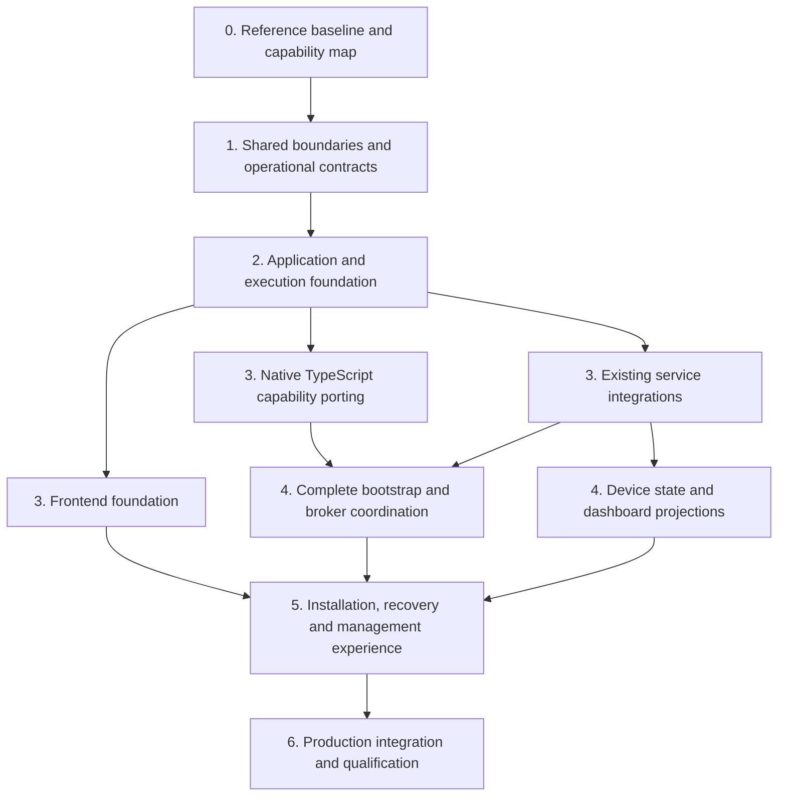
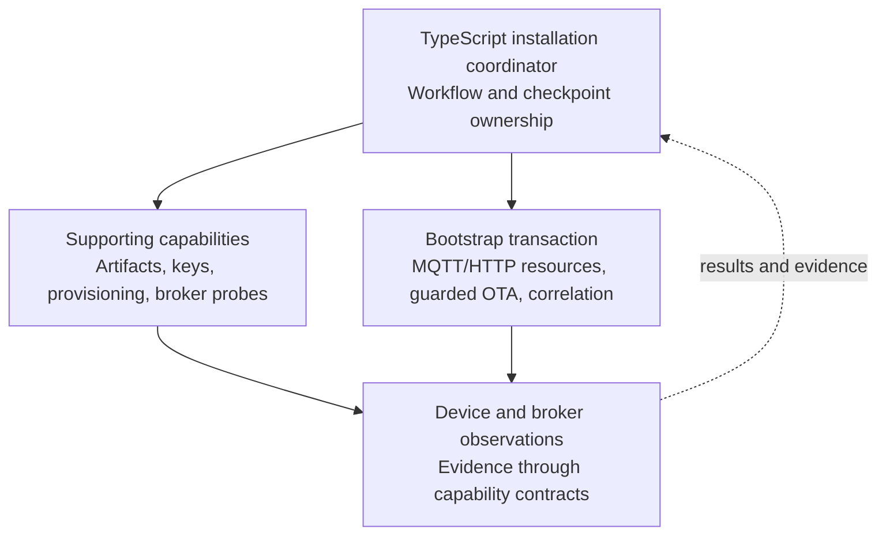

# Petlibro Management — Migration & Implementation Sequence

> **Revised implementation target (October 14, 2026):** management
> capabilities are ported natively to TypeScript and run in an independently
> supervised worker. The standalone Python installer and its tests remain an
> independent reference path; management does not import or execute them. Read
> older “Python extraction” wording as historical sequencing guidance only.

**Planning baseline:** October 13, 2026  
**Related document:** `petlibro-management-architecture-coverage-map.md`  
**Reference repository:** [Petlibro-Home-Assistant (`develop`)](https://github.com/tannerln7/Petlibro-Home-Assistant/tree/develop)

Using the architecture coverage map, the recommended approach is a **coordinated, dependency-driven implementation** with several workstreams advancing together.

We shouldn't build the whole frontend before the backend, finish capability porting before developing the application, or start implementing TypeScript services without understanding what the existing capabilities actually require.

Instead, we establish the critical boundaries first, then progressively connect real implementations through them.

The goal is that every stage strengthens the intended final architecture rather than introducing temporary structures that must eventually be replaced.

## 1. Organize the work into four synchronized workstreams

The architecture map identified eight responsibility regions (A–H). Those remain our permanent architectural boundaries.

For implementation planning, however, group the work into four practical workstreams.

### Track 1 — Existing capability migration

Port proven installer responsibilities into independently usable native
TypeScript capabilities while preserving behavior, tests, safety constraints,
and technical transaction ownership. Keep the standalone Python installer
working as an independent CLI and parity reference; management neither imports
nor executes it.

**Architecture regions:** C, E.

### Track 2 — TypeScript application foundation

Build the execution contracts, worker integration, operation coordination, state persistence, application services, structured events, and deployment interfaces.

**Architecture regions:** B, E, F, G, H.

### Track 3 — New management features

Build the React application, action forms, installation experience, dashboard, diagnostics, operation history, logs, settings, and recovery interfaces.

**Architecture regions:** A, B, G.

### Track 4 — Existing system integration

Connect the management application to AppDaemon, go2rtc, the State Agent, Mosquitto, Home Assistant Supervisor, and the add-on deployment environment.

Preserve existing operational authorities while preparing their future replacement boundaries.

**Architecture regions:** D, E, F, H.

These tracks should not become separate isolated projects. They organize work while deliberately coordinating the contracts between them.

### Overall implementation dependency graph

The shared contracts form the foundation; native capability porting, runtime integration, and frontend development then advance in parallel. The complete application comes together as those streams converge.

The numbering identifies implementation waves, not one enormous Codex assignment per wave.

## 2. Design dependencies must be distinguished from implementation dependencies

A component can **define requirements for another component without needing to be implemented first**.

For example:

- The operation viewer defines what progress and log information it needs.
- The event contract defines the common representation.
- The native capability worker implements production of those events.
- The operation manager provides their context, history and lifecycle.
- The frontend renders them.

Establish those requirements together, but the finished frontend is not required before writing the worker event publisher.

Likewise, the device's protocol constraints define what the capability must enforce, but the application coordinator may need to know about those constraints before the capability has been extracted.

**Rule for Codex work: Define a boundary from both sides before implementing either side. Then allow each side to develop independently against that agreed contract.**

This avoids assumptions without requiring the entire system to be implemented strictly in dependency order.

---

## 3. Proposed implementation waves

Each wave establishes specific interfaces and working capabilities that subsequent work can safely depend on.

### Wave 0 — Establish the reference baseline and migration model

**Classification:** Foundation.

Before changing code, establish precisely what is being migrated.

The existing repository contains real, tested behavior. The migration repository becomes the new implementation environment, but the two must not silently diverge.

| Track | Work in this wave |
|---|---|
| Capability migration | Inventory installer modules, dependency relationships, shared resources and transaction boundaries |
| TypeScript foundation | Derive initial capability boundaries and identify cross-language information |
| New frontend | Confirm page responsibilities and the kinds of operations and observations each page needs |
| Existing integration | Inventory current AppDaemon, go2rtc, broker, configuration and add-on authority contracts |

The outputs should include a capability dependency map, source revision/provenance record, behavioral invariants, existing test coverage, and a list of areas where compatibility tests are missing.

This is also where newer local installer and camera changes are reconciled with the version published to GitHub. The migration must not accidentally begin from an outdated snapshot.

**Exit condition:** The team knows which existing behaviors must survive and which dependencies belong to which migration units. The current repository remains operational and serves as the behavioral reference.

### Wave 1 — Define the shared boundaries and resolve architecture-changing uncertainties

The coverage map becomes precise enough to implement.

Define the relationships around capabilities, operations, state, events, resource ownership, authentication, and existing service integrations.

Not every class or endpoint needs to be designed now. But ownership and interoperability contracts need to be settled.

| Boundary | What must be established |
|---|---|
| **B ↔ C** Coordinator/capabilities | Requests, results, sessions, execution authority, cancellation, resource requirements |
| **B/C ↔ F** Operations/persistence | Durable job state, protected references, interrupted transaction records |
| **B/C/D ↔ G** Observability | Structured logs, progress, telemetry, evidence, event ordering and history |
| **A ↔ B** UI/application | Action definitions, dynamic inputs, status snapshots, decisions and errors |
| **B ↔ D** Runtime integrations | Observation versus authorized command versus authority transfer |
| **All ↔ H** Platform | Process ownership, authentication, transport, security and deployment isolation |

Four feasibility questions should be resolved in this wave because they could otherwise invalidate later work:

1. **Ingress and direct-browser hosting:** Can the selected TanStack Start runtime, routing, assets and live connections operate cleanly in both modes?
2. **Same-host MQTT handoff:** What verified sequence allows the temporary broker and Mosquitto to alternate ownership of port 1883 while preserving existing installation guarantees?
3. **Startup independence:** Can the management application run before any feeder is configured, even when AppDaemon or its configuration initialization fails?
4. **Add-on configuration authority:** How can configuration be safely applied and its adoption verified without giving the web application uncontrolled access to Supervisor or restarting a critical transaction?

Also evaluate build-time versus runtime compilation of the ARM artifacts here, because it determines the worker's production dependencies and artifact-custody requirements.

These are **bounded technical investigations**, not throwaway implementations. Their output is a verified constraint or design decision that the final architecture incorporates.

**Exit condition:** Critical interfaces are coherent, and no unresolved platform assumption would force redesign of the capability boundary later.

### Wave 2 — Build the permanent execution foundation

Implement the complete infrastructure necessary to host any capability correctly.

This includes TypeScript service composition, worker communication, operation lifecycle, durable records, event publication, and process supervision.

In parallel, establish the real TanStack Start application shell and independent native-TypeScript worker process.

| Workstream | Deliverable |
|---|---|
| Capability migration | Native worker host that can own a live capability session and expose a bounded operation; standalone Python installer retained as parity reference |
| TypeScript foundation | Capability adapters, operation manager, journal, event distribution and lifecycle reconciliation |
| Frontend | Application shell, routing, authentication boundary, reusable operation/progress/log components |
| Integrations | Add-on process topology, management startup independence, Ingress and direct-browser transport |

The key validation is one **complete vertical execution path**, using a safe read-only capability.

For example, a State Agent health inspection can travel through the TypeScript application, native worker, result contract, operation journal, and live event stream, then appear in the frontend.

That proves the real architecture—not just that the individual services compile.

It should also demonstrate browser disconnection, management-server restart, worker unavailability, and event reconnection.

This read-only operation is not intended as an initial product; it is a representative integration test for the infrastructure the final product uses.

**Exit condition:** A real capability executes through the final architectural
boundaries with correct state ownership, durable evidence/results, explicit
ephemeral-log behavior, and reconnection semantics.

### Wave 3 — Port native TypeScript capabilities while building existing-system integrations

This is where workstreams genuinely progress in parallel.

The execution foundation exists. Real installer behavior moves into native TypeScript capability units, preserving parity against the standalone Python reference, while adapters exposing existing operational information are developed simultaneously.

#### Independent or relatively low-coupling capabilities

| Capability group | Existing sources | Initial boundary |
|---|---|---|
| OEM provisioning | `installer/protocol.py`, `bootstrap.py` | Validated UDP provisioning request and transmission evidence |
| Artifact preparation | `payload.py`, `dropbear.py`, `prepare()` | Verified artifacts, protected output references and build provenance |
| Credential/key handling | `bootstrap.py` | Secure creation, validation, retrieval and custody |
| Broker connectivity checks | `mqtt_server.py` | Authentication result and observations |
| State Agent inspection | `bootstrap.py` | Authenticated health/version responses |

These capabilities can be exposed without migrating the entire bootstrap session at once.

For artifact preparation, the interface should remain independent of whether an ARM binary was built at image-build time or at runtime.

#### Stateful and tightly coupled bootstrap capabilities

| Capability group | Existing sources | Shared ownership |
|---|---|---|
| Temporary MQTT session | `mqtt_server.py`, `protocol.py` | Broker socket, feeder identity, connection generations |
| OTA delivery and verification | `bootstrap.py`, `mqtt_server.py` | MQTT session, HTTP payload listener, OTA correlation and transaction state |
| Bootstrap session lifecycle | `bootstrap.run()` | Technical resource coordination and safe release |

These can have multiple internal classes and modules, but must preserve their live-resource dependencies.

Establish their final responsibility boundaries in Wave 3; complete integration and transaction behavior in Wave 4.

#### Parallel work: existing operational adapters

While native capability porting proceeds, runtime observation adapters can advance independently.

| Integration | Initial responsibility |
|---|---|
| AppDaemon | Observe controller readiness, MQTT state, verified feeder state and operational activity |
| go2rtc | Observe camera stream configuration, status and relevant diagnostics |
| State Agent | Expose authorized inspection without taking over AppDaemon's routine reconciliation |
| Mosquitto | Broker reachability, authentication results, listener availability |
| Home Assistant | Configuration status, service state and supported management operations |
| Device discovery | Correlate management records with existing feeder identity and discovery observations |

This track also establishes the **device projection boundary** the dashboard consumes.

The dashboard should request a coherent `DeviceOverview` from the management application, rather than separately understanding AppDaemon MQTT topics, go2rtc status files, State Agent endpoints and the installation database.

That projected view must retain source identity, freshness and availability.

It is also the stable contract for a future TypeScript AppDaemon replacement.

#### Parallel work: frontend components

Frontend development proceeds against established application and event contracts.

Build reusable components before committing to final detailed layouts of every page:

- Action forms and validation feedback.
- Operation status and progress presentation.
- Live/collapsible execution logs.
- Checkpoints and confirmation dialogs.
- Device/service health displays.
- Diagnostic results and structured data viewers.
- Source-aware error and availability presentation.

These are permanent shared components, independent of the worker's implementation language.

**Exit condition for Wave 3:** Each extracted capability is independently usable through its contract; routine-service observations are available through defined adapters; reusable UI components consume real application models.

### Wave 4 — Integrate the complete bootstrap transaction and application workflow

This is the most technically sensitive convergence point.

At this stage, the system has:

- A durable operation manager.
- Stable capability interfaces.
- The native capability worker.
- Extracted supporting operations.
- Defined event and logging facilities.
- Platform and broker integration contracts.
- Reusable frontend operation components.

Now connect them into the **complete installation lifecycle**.

#### Capability side

The native bootstrap subsystem must support the actual technical transaction:

- Temporary broker acquisition and session handling.
- OEM identity capture and connection correlation.
- Payload serving with appropriate restrictions.
- OTA publication, acknowledgment and terminal-result handling.
- Post-OTA restart observations.
- Resource cleanup and safe interruption semantics.

Critical technical steps remain under the bootstrap capability's authority.

#### Application side

The TypeScript coordinator owns the user-facing installation workflow:

- Selecting and validating the installation target.
- Gathering configuration and credentials.
- Scheduling artifact preparation.
- Coordinating broker availability and operator checkpoints.
- Invoking the necessary device capabilities.
- Recording outcomes and durable evidence.
- Determining whether integration verification is complete.
- Presenting supported recovery choices if an operation fails.

The coordinator must not duplicate the MQTT session state machine. The capability must not independently decide which page the user should see next.

#### Installation workflow composition

#### Broker-handoff boundary

Wave 4 implements the verified sequence established in Wave 1.

The coordinator must distinguish:

- Requesting Mosquitto to stop.
- Observing that port 1883 is available.
- Acquiring that port for the temporary broker.
- Confirming the feeder actually connected.

Similarly, final broker credential acceptance is different from successful feeder reconnection.

Preserve the existing pre-OTA final-broker credential validation even if that requires additional broker transitions.

#### Integration configuration

The workflow must create or apply required add-on configuration through the selected authority mechanism.

The management UI must remain available while operational services are restarted or reconfigured.

Applying options must not accidentally stop the management application's active execution infrastructure.

#### Frontend convergence

The installation page becomes fully functional:

- Current installation state is visible.
- Required inputs appear at appropriate checkpoints.
- Long-running work displays stages, progress and execution logs.
- Browser disconnection does not terminate execution.
- Failures show their actual state and available recovery paths.
- Completion links directly to the managed device dashboard.

**Exit condition:** Full supported installation executes through the application, including credential capture, broker handoff, guarded OTA and integration verification, with correct failure and uncertain-outcome handling.

### Wave 5 — Complete the management and recovery application

By this stage, installation works through the intended architecture, and the application has established operational adapters.

The focus becomes completing the broader management experience—not inventing another backend.

| Page / feature | Primary dependencies | Responsibility |
|---|---|---|
| Overview | Device projections, system health, operation history | Present overall integration status |
| Devices | Identity/registry, discovery observations | Show known and managed feeders |
| Device details | AppDaemon, State Agent, go2rtc projections | Present complete device status |
| Installation | Coordinator, bootstrap capabilities, operation components | Guided installation |
| Actions / maintenance | Action catalog, capability registry | Execute supported actions |
| Operations | Job journal, progress, logs, results | Inspect active and historical work |
| Diagnostics | Runtime adapters, device inspection, observations | Explain and investigate failures |
| Logs | Durable event history plus on-demand raw-log subscriptions | Filter durable evidence; inspect ephemeral execution/runtime output without changing producer retention |
| Events / history | Event journal, operation history | Review significant system changes |
| Settings | Configuration ownership, protected storage, Supervisor interface | Manage application and integration settings |

Areas requiring special attention:

- **Recovery should reuse capabilities, not reuse assumptions.** A recovery action may target a feeder whose installation state is uncertain, so it needs its own applicable-state checks and verification.
- **Diagnostics should use authoritative observations.** The application can assemble useful reports without claiming that its aggregated state is the device's underlying truth.
- **AppDaemon should remain operationally independent.** Its existing Home Assistant entities and commands must work without the management frontend.
- **Streaming should already be foundational.** Dashboard telemetry and logs use the event distribution contracts established in Wave 2, rather than separate transports per page.

Distinguish user-facing health summaries from detailed diagnostic evidence. The dashboard stays concise; diagnostics expose provenance and uncertainty.

**Exit condition:** All planned management functions exist, providing a coherent experience before, during and after installation—not merely an installer with a status page.

### Wave 6 — Production integration, compatibility and failure qualification

This is the final convergence wave, although important validation runs continuously in earlier waves.

| Area | Validation |
|---|---|
| Add-on packaging | Management Node/worker, AppDaemon and go2rtc are packaged and independently supervised |
| Fresh setup | Management UI starts before device and broker configuration is complete |
| Existing installations | Previously configured users can access the dashboard without reinstalling |
| Home Assistant compatibility | Existing MQTT entities, identities, commands and state behavior remain intact |
| Ingress and direct browser | Routing, assets, authorization, streaming and reconnection work in both environments |
| Operation continuity | Browser, Node, worker and add-on interruptions behave as specified |
| OTA safety | Correlation, evidence, fail-closed behavior and ambiguous results remain correct |
| Configuration | Options and service transitions are applied and verified through the approved mechanism |
| Secrets | Logs, event history, browser payloads, exports and backups preserve secret handling |
| Source equivalence | Native capability behavior matches the standalone Python reference implementation |
| Performance | Idle resource use, logs, telemetry and active operations remain within acceptable bounds |

Distinguish **host-side deterministic tests** from **live feeder tests**. Live validation is necessary for final qualification but is not a substitute for repeatable protocol and transaction tests.

A new management add-on must not create a second active AppDaemon controller for the same feeder during qualification. Test deployments need controlled isolation or one-controller-at-a-time cutover.

**Exit condition:** The complete initial application satisfies its defined behavior, security, deployment and recovery requirements.

---

## 4. How the tracks advance together

| Wave | Capability migration | TypeScript backend | Frontend / new features | Existing integrations |
|---|---|---|---|---|
| **0 — Baseline** | Inventory dependencies and behaviors | Map authority boundaries | Define page/data needs | Inventory existing contracts |
| **1 — Contracts** | Define capability units | Define shared semantics and lifecycle | Define input/output needs | Resolve platform feasibility |
| **2 — Foundation** | Native worker host + safe test operation | Execution, persistence, events, adapters | Application shell, operation UI | Process topology and browser hosting |
| **3 — Modularization** | Port supporting capabilities and bootstrap session boundaries | Implement capability wiring and device projections | Forms, logs, diagnostics, reusable views | AppDaemon, go2rtc, broker, State Agent |
| **4 — Bootstrap** | Complete guarded transaction capabilities | Installation coordinator, broker handoff, recovery state | Complete installation experience | Configuration application and service transitions |
| **5 — Management** | Add supporting inspection/recovery capabilities where needed | Finish actions, diagnostics and configuration services | Complete dashboard and management pages | Finalize supported observation and action integrations |
| **6 — Qualification** | Regression and fault testing | Lifecycle, durability and security testing | Full UI/browser testing | Add-on packaging and compatibility |

The major advantage is that work never becomes isolated from its consumers.

When reference behavior is ported, the coordinator already knows what it must
accept. When dashboard components are built, their data contracts exist. When
integrations are added, their authority boundaries are defined.

## 5. Cross-track synchronization points

Require a small number of explicit synchronization points to prevent independently developed areas from quietly drifting apart.

### Contract agreement

Before two areas are implemented independently, both sides agree on inputs, outputs, ownership, failure behavior and shared semantics.

### Boundary integration

Once an implementation exists, validate it through the actual boundary rather than relying exclusively on mocks.

### Authority and lifecycle verification

Confirm resource ownership, restart behavior, state freshness, secret handling and whether operations can safely be repeated or interrupted.

### Compatibility verification

Confirm that extraction, migration or integration has not unintentionally changed existing device behavior or Home Assistant contracts.

These checkpoints don't require stopping all development; they apply to affected boundaries.

For example, a React log viewer can proceed independently of artifact preparation if the event contract is stable. A change to bootstrap session ownership needs coordination with operation management, Python adapter and recovery workflow.

## 6. Translate the sequence into Codex-sized work

Each implementation assignment should own **one coherent responsibility or tightly coupled dependency group**, not an arbitrary set of files.

Its scope identifies:

- Relevant regions of the coverage map.
- Interfaces it may change.
- Dependencies.
- Authoritative state.
- Tests required to establish correctness.

**A Codex assignment must not silently extend another subsystem's responsibilities merely because that makes its immediate implementation easier.**

If capability-worker development exposes a need for an operation-state change, that is a contract question involving coordination and events.

If dashboard development exposes missing data, that is an observation-contract question involving the source authority.

If broker handoff needs a process-supervision change, that is a platform-boundary question.

A developer can identify and propose these changes, but architecture updates should be deliberate rather than accumulating inside whichever module is being edited.

Three types of assignments are appropriate:

| Assignment type | Purpose |
|---|---|
| **Boundary definition** | Resolve requirements, dependencies and ownership before implementation |
| **Capability/component implementation** | Implement an established responsibility behind its contract |
| **Integration and qualification** | Connect independently implemented regions and prove their interaction |

This keeps assignments bounded while preserving system-wide context.

## 7. Keep the two repositories coordinated without creating duplicate ownership

The existing repository remains the source of tested behavior. The migration repository becomes the environment for the new management architecture.

Maintain explicit provenance for ported behavior and parity tests. Do not
import Python installer modules into the management runtime.

Changes to the original implementation during development must be deliberately reconciled into the migration repository. If the migration finds a genuine defect in the original implementation, decide whether to fix it in both places rather than allowing an unexplained behavioral difference.

The eventual deliverable is one integrated add-on. Two development repositories are a migration convenience, not a requirement for two running systems.

### Future TypeScript migrations

After Wave 3 establishes stable capability boundaries, individual native TypeScript ports can begin whenever their dependency closures and compatibility evidence permit. They need not wait for Wave 6.

The AppDaemon migration is larger in scale. Initial work prepares its observation and authority boundaries, while routine-controller replacement remains a separately qualified effort. Preserve existing single-writer controls until deliberate cutover.

## 8. Trace implementation coverage against the complete architecture map

The coverage map identifies 13 areas requiring consideration. Tie each to the waves establishing its boundary and implementing its behavior.

| Coverage area | Boundary established | Main implementation |
|---|---|---|
| Presentation and navigation | Waves 0–1 | Waves 2–5 |
| Action and workflow coordination | Wave 1 | Waves 2–5 |
| Device capability system | Waves 0–1 | Waves 2–4 |
| Native capability worker | Wave 1 | Waves 2–4 |
| Routine controller integration | Waves 0–1 | Waves 3–5 |
| Camera/media integration | Waves 0–1 | Waves 3–5 |
| Home Assistant integration | Wave 1 | Waves 2–6 |
| Identity and configuration | Waves 0–1 | Waves 2–5 |
| Persistent application state | Wave 1 | Waves 2–5 |
| Observability and diagnostics | Wave 1 | Waves 2–5 |
| Security and trust | Wave 1 | Waves 2–6 |
| Lifecycle and fault recovery | Wave 1 | Waves 2–6 |
| Migration compatibility | Waves 0–1 | Every subsequent wave |

Every coverage area should have an implementation owner, dependent components, relevant validation and a clear status. This helps verify that no architectural responsibility falls between work packages.

## 9. Where implementation should actually begin

The first implementation work should center on the **Capability and Execution Foundation**: the shared boundary between existing functionality and the new application.

### Capability side

- Migration-unit boundaries.
- Dependency closure.
- Technical state.
- Native capability worker.

### Application side

- Operation lifecycle.
- State storage.
- Events.
- Typed contracts.
- Capability adapters.

### Adjacent requirements included from day one

- Frontend action descriptions and progress/log presentation.
- Independent management startup.
- Authentication.
- Existing-service observation.
- Migration compatibility.

This is the natural starting point because nearly everything else depends on it.

**Do not immediately task Codex with implementing that entire foundation.** First divide it into concrete responsibility groups and dependencies, and establish each boundary before coding.

Specifically, define together:

1. The capability model and dependency-closure rules.
2. The operation/job model and the distinction from capability-owned sessions.
3. The request/result/event contracts.
4. The authority and persistence model for operation state.
5. The worker integration boundary.
6. The lifecycle relationship between the management service, worker and existing services.

Once these relationships are defined, initial implementation assignments can be divided confidently and other workstreams can begin in parallel.

## Final architectural assessment

**This is not starting small in architectural scope. It is implementing a fully considered system in dependency-aware pieces.**

The sequence avoids three extremes:

- Rebuilding the Python installer before understanding how the application consumes it.
- Constructing a frontend around invented data.
- Designing an elaborate TypeScript platform before proving how it interacts with real device capabilities.

Most importantly, the architecture is meant to become progressively more complete **without its boundaries changing whenever a new component is implemented**.

Use this migration sequence alongside the coverage map as the basis for planning detailed implementation boundaries and Codex assignments. The coverage map remains the reference for responsibilities, authority and state ownership; this document describes the order and synchronization of implementation work.
